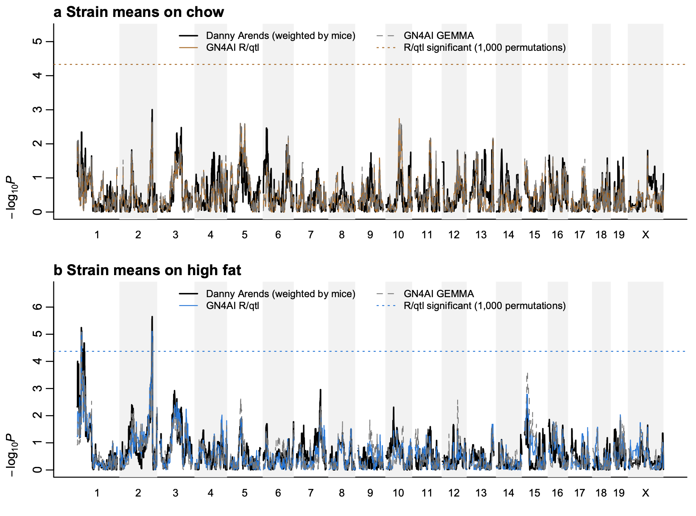
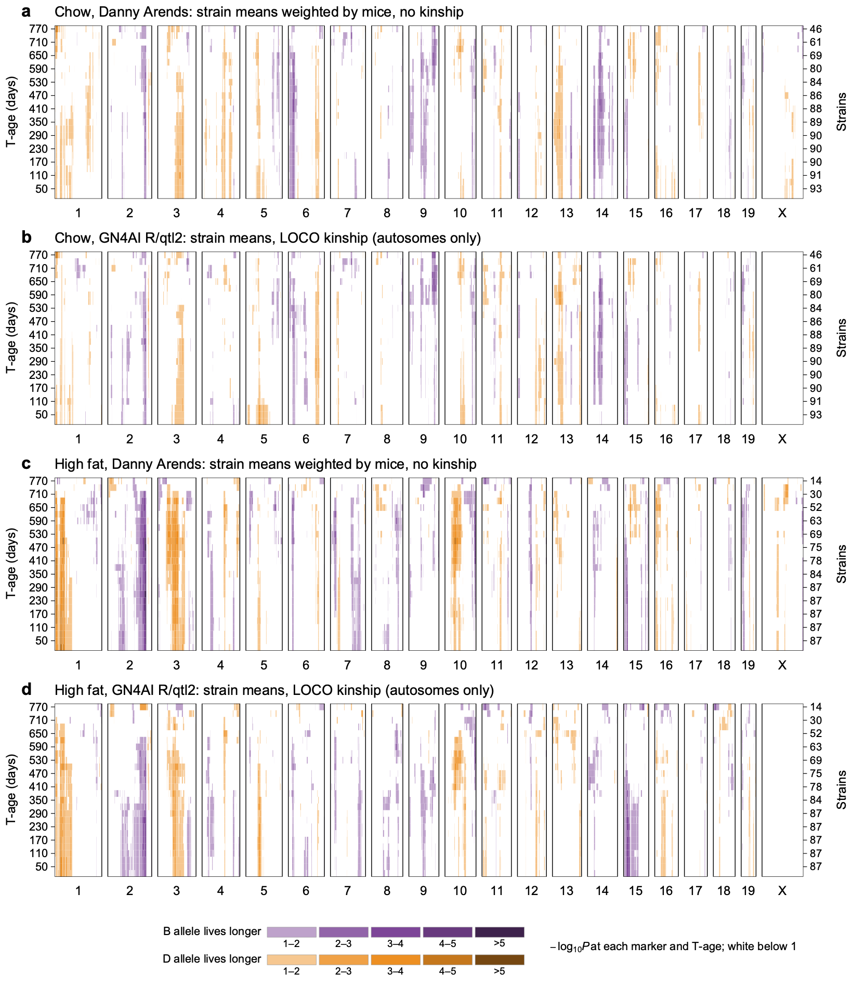

# GN4AI-beta test drive: BXD lifespan strain means

**Exploratory, 21 November 2026.** Opus 5.5 Extra (Claude, Anthropic) ran it at Rob Williams's request, after Pjotr Prins asked Rob to test GN4AI-beta before its release this week. Rob: "What we might try to do using Beni's updated and corrected file is some mapping that Danny has already done."
- **Code:** [`GN4AI/strain_means.R`](../GN4AI/strain_means.R) builds the strain means, [`GN4AI/test_drive.sh`](../GN4AI/test_drive.sh) sends and maps them, and [`GN4AI/compare_Danny.R`](../GN4AI/compare_Danny.R) sets the scans beside Danny's.
- **Outputs:** [`output/GN4AI/`](../output/GN4AI/), including every call's timing (`timings.txt`), every scan (`*.tsv.gz`) and GeneNetwork's own plots (`*.svg`).
- **Service:** https://vesuvio.pu.ac.ke/gn4, build `5b68da6-dirty` of 21 November 2026. SKILL.md was read from the docs repository at commit `a621bb3` (19 November); Rob's copy of 11 November predates baskets and the ravanan runner.

## In brief

- **It works, with four faults that matter.** 187 timed calls: baskets, R/qtl, R/qtl2, GEMMA through both runners, permutations, covariates and plots.
  - **Given one value per mouse, R/qtl2 keeps the last mouse of each strain and drops the rest without saying so** (item 20).
  - **No GEMMA route fits covariates,** because `/compute/gemma` now runs ravanan (items 6 and 14).
  - **R/qtl2 accepts a covariate and then leaves it out** (item 15).
  - **`/plot/rqtl` will not draw R/qtl2 scans** (item 12).
- **We repeated Danny Arends's strain-means maps (his Fig. 2, top two rows).** The strain means are at T-age 20, so every mouse counts, and they come from Beni Mozhui's corrected file.
- **High fat: GeneNetwork finds Danny's two peaks,** on proximal Chr 1 at 23.5 Mb, in the Vita1a–Vita1b interval, and on Chr 2 at 157.5 Mb. Both clear R/qtl's significance threshold from 1,000 permutations.
- **Chow: nothing is significant, in GeneNetwork or in Danny's maps.** The top marker differs: Chr 10 in GeneNetwork, Chr 2 in Danny's.
- **The two differ because Danny weights each strain mean by its number of mice.** GeneNetwork gives every strain the same weight, which is what Rob wants for strain means: weighting by N "will seriously screw up the mapping" (below). A local check reproduces both maps (r = 0.98 to 0.999).
- **Beni's corrected NAM ages change three strain means, by 8 to 24 days, but not the map.** The largest change in LOD is 0.11, and nothing is significant either way.
- **The full actuarial scan, 20 to 770 days in 30-day steps, ran in 6 minutes** (108 R/qtl2 scans, with and without kinship). Danny's maps are a regression of strain means weighted by mice, without kinship, at every T-age on chow and to 620 days on high fat. From 650 days on high fat the match weakens. His own model, read from his code, reproduces every map: it adds each strain's set-up age, in 180-day classes, as a covariate.
- **Danny's strain-mean maps look uncorrected for kinship.** His high-fat map matches scans without kinship better than scans with it (r = 0.80 against 0.71).
- **Rob prefers mapping every mouse, with full cofactors and kinship.** GN4AI cannot do that yet, so it heads the feature requests (item 18). The limit is GN4AI's, not R/qtl2's: R/qtl2 itself takes kinship, cofactors and weights together.
- **pangemma gives GEMMA's results.** On chow its rows are identical to gemma-gn2's; on high fat they differ by at most 0.001 in −log10 *p*.
- **Speed.** An R/qtl scan takes 8 s and an R/qtl2 scan 3 s. GEMMA takes 10–22 s the first time and 4 s when cached. 1,000 permutations take from 22 s to nearly 8 minutes.
- **GeneNetwork's published lifespan traits are older than the curated file.** Their descriptions date them to December 2024 (chow, high fat) and April 2024 (NAM).
  - **They leave out strains with fewer than 3 mice,** as Rob guessed.
  - **Some strain means differ:** BXD86 on high fat is 610 days in GeneNetwork against 724 in the file.

## What we sent

Strain means of age at death, following Danny's rule: at a T-age, each strain with at least 3 mice alive beyond it, set-up age ignored, parents and F1s left out. This rule gives his strain counts at 20 days (`qc/Mapping_files_QC.md`). His actuarial maps count mice alive *at* T (age ≥ T), which gives the same strains at 20 days (see "Actuarial scans" below). Each column went to GeneNetwork as a basket, a private column of values that the compute calls can map by name.

| Basket | Diet | Ages from | Strains | Mice |
|---|---|---|---|---|
| `lifespan_CD_T20` | chow | Beni's file (the same as Danny's on chow) | 93 | 897 |
| `lifespan_HF_T20` | high fat | Beni's file (the same as Danny's on high fat) | 87 | 800 |
| `lifespan_NAM_T20_Beni` | NAM | Beni's file: four corrected ages | 21 | 135 |
| `lifespan_NAM_T20_Danny` | NAM | Danny's file: one corrected age | 21 | 135 |

All 93, 87 and 21 strain means aligned onto GeneNetwork's BXD.8 genotypes by name.

## Timings

Wall-clock times from Rob's Mac, every call in `output/GN4AI/timings.txt`.

| Step | Seconds | Reply |
|---|---|---|
| Store or revise a basket | 0.2 | 1 kB |
| Fetch a trait's values | 0.2 | 4–12 kB |
| R/qtl scan, 21,056 markers | 7.5–7.9 | 1.1 MB |
| R/qtl2 scan, with or without kinship, 20,453 autosomal markers | 3.1–3.3 | 0.85 MB |
| R/qtl with 1,000 permutations | 221 (chow, 93 strains), 463 (high fat, 87), 21–22 (NAM, 21) | 1.1 MB |
| GEMMA through ravanan, first run | 21.6 (chow), 15.3 (high fat), 15.4 and 9.8 (NAM) | 2.1 MB |
| GEMMA, repeated (cached) | 4.3 | 2.1 MB |
| `/compute/gemma` (the wrapper runner) | 4.2–4.4 | 2.1 MB |
| A plot | 0.8–1.5 (one of 4.9) | 0.26 MB |
| R/qtl2 actuarial scans, 108 sent inline | 2.9–4.6 each, 359 in all | 0.85 MB each |
| pangemma (`engine: "pangemma"` on `/compute/gemma/ravanan`) | 15.2–15.4 | 2.1 MB |

## Results

| Basket | Engine | Strongest marker | Chr, Mb | Score | R/qtl thresholds, 1,000 permutations |
|---|---|---|---|---|---|
| chow | R/qtl | rsm10000007009 | 10, 66.6 | LOD 2.17 | significant 3.70, suggestive 2.76 |
| chow | GEMMA | rsm10000007009 | 10, 66.6 | −log10 *p* 2.67 | |
| high fat | R/qtl | rsm10000001145 | 2, 157.5 | LOD 4.47 | significant 3.75, suggestive 2.79 |
| high fat | R/qtl, next peak | rsm10000000521 | 1, 23.5 | LOD 4.44 | |
| high fat | GEMMA | rsm10000000521 | 1, 23.5 | −log10 *p* 5.08 (Chr 2: 4.69) | |
| NAM, Beni's ages | R/qtl | rsm10000001229 | 2, 45.6 | LOD 2.33 | significant 3.50, suggestive 2.69 |
| NAM, Danny's ages | R/qtl | rsm10000001229 | 2, 45.6 | LOD 2.38 | significant 3.53, suggestive 2.70 |
| NAM, Beni's / Danny's ages | GEMMA | rsm10000013988 | 19, 12.5 | −log10 *p* 3.70 / 3.77 | |

- **R/qtl reports LOD and GEMMA reports −log10 *p*.** The two scales differ, so 5.08 and 4.44 at the same marker do not disagree.
- **On chow, kinship explains almost none of the variance in the strain means.** GEMMA's PVE is 0 to 0.08, depending on the chromosome left out, so GEMMA comes close to a plain regression and tracks R/qtl at r = 0.99 over markers.
- **On high fat, kinship explains more,** with PVE up to 0.60. GEMMA then departs further from R/qtl (r = 0.90), as on Chr 15.

### Chow and high fat beside Danny's maps



*Danny's maps (black) beside GN4AI's R/qtl (diet color) and GEMMA (grey, dashed), as −log10 P at every marker. R/qtl's LOD is converted with the F test of the same regression. The dotted line is R/qtl's significance threshold from 1,000 permutations.*

- **On high fat, the two agree on the peaks.** Chr 2 at 157 Mb: 5.65 in Danny's map, 5.11 in R/qtl. Chr 1 at 23 Mb: 5.24 against 5.08.
- **On chow, they rank weak peaks differently.** Danny's strongest is Chr 2 at 157 Mb (3.00), where R/qtl gives 2.62. R/qtl's strongest is Chr 10 at 67 Mb (2.74), where Danny's map gives 1.62. All of these are below R/qtl's threshold, which is 4.33 on this scale.
- **Over all markers, Danny's maps correlate with GN4AI's R/qtl at r = 0.69 on chow and 0.80 on high fat.**

**Why: a lesson in weighting.** A strain mean from 20 mice is more precise than one from 3.
- **Danny's maps give each strain mean a weight equal to its number of mice.** Locally, on every 10th marker, a regression of strain means weighted that way matches his maps at r = 0.988 on chow and 0.981 on high fat.
- **GeneNetwork gives every strain the same weight.** The same regression without weights matches GN4AI's R/qtl at r = 0.997 and 0.999.
- **So each map is right for its own model.** The chow peak moves because the strains that carry it differ in how many mice they have.
- **Weighting by N is the wrong choice for these strain means.** Rob: "It is a really bad idea to weight each strain by the number of mice. The range is quite high among strains and if the weighting is by N it will seriously screw up the mapping." And: "Much better would be to forget about any weighting, provided a strain has 3 or more per group. But even better is to simply map the individuals with a full kinship correction."
  - **Why N overweights large strains.** A strain mean varies for two reasons: the strain's true mean differs from the others, and its few mice scatter around that mean. Only the second shrinks with N. On chow, the SD within strains is 183 days and the SD of the true strain means is 105 days (a one-way analysis of variance). Weighting by the variance of each mean, a 23-mouse strain counts 1.8 times as much as a 3-mouse strain; weighting by N, it counts 7.7 times as much. On high fat, 1.6 against 7.3.
  - **So equal weights, with at least 3 mice per strain, are close to the right weights here,** and they are what GeneNetwork uses. Individual mice with kinship are better still (item 18).

### Does Danny's map correct for kinship?

Rob: "I am not sure what method and model Danny Arends is using, but I hope R/qtl2 that does correct for kinship." To test it, the same baskets went through R/qtl2 with LOCO kinship and without kinship, and each scan was compared with Danny's map over markers.

| Scan | Kinship | Correlation with Danny's map, chow | High fat |
|---|---|---|---|
| Strain means weighted by mice per strain (local, every 10th marker) | none | 0.988 | 0.981 |
| GN4AI R/qtl | none | 0.688 | 0.797 |
| GN4AI R/qtl2 | none | 0.692 | 0.800 |
| GN4AI R/qtl2 | LOCO | 0.692 | 0.713 |
| GN4AI GEMMA | LOCO | 0.689 | 0.705 |

- **On chow, kinship changes little,** so this test cannot tell the models apart there.
- **On high fat, kinship matters,** and Danny's map sides with the scans without it (0.80 against 0.71).
- **The weighted regression without kinship reproduces his map almost exactly.** A scan with kinship would likely differ from his by about as much as GN4AI's two R/qtl2 scans differ from each other (r = 0.91 on high fat).
- **So his strain-mean maps most likely do not correct for kinship.** His code confirms it (below): they are weighted regressions, `lm()`, with set-up class as a covariate.
- **His maps of individual mice (his Fig. 2, rows 3–4) use another model:** `lmer(age ~ diet + vivarium + set-up class + genotype + (1 | strain))`, with a diet × genotype term for the interaction. The random intercept for strain accounts for mice of the same strain. There is no kinship matrix, so related strains are treated as unrelated.
- **With kinship, the high-fat peaks hold.** R/qtl2 with LOCO kinship peaks on Chr 1 at 23.5 Mb (LOD 4.25).

**Rob's preference.** Rob: "I actually prefer to use ALL of the data and map at the individual level with full cofactors. The kinship handles the variable number of individuals per genotype well."
- **This replaces the weighting question:** each mouse enters once, and the kinship matrix accounts for mice of the same strain.
- **In these data the cofactors could include diet, vivarium and birth year.** Part 5 showed the last two matter for nicotinamide.
- **GN4AI cannot do it yet.** A basket or matrix holds one value per strain (item 18).

**Is that a limit of R/qtl2 or of GeneNetwork?** Rob: "R/qtl2 maps with kinship, or can. Is this a limitation of the GN implementation?" It is GeneNetwork's. Karl Broman's R/qtl2 documentation ([user guide](https://kbroman.org/qtl2/assets/vignettes/user_guide.html); `scan1` in [R/scan1.R](https://github.com/rqtl/qtl2/blob/main/R/scan1.R)) shows `scan1()` taking everything this design needs:
- **Kinship,** as one matrix or as a list of LOCO matrices. GN4AI's R/qtl2 does use it: its scans with and without kinship differ (table above).
- **Additive and interactive covariates** (`addcovar`, `intcovar`). The interactive ones give a gene × diet test like Danny's Fig. 2, rows 3–4.
- **Weights,** with or without kinship. The residual covariance becomes σ²[h²·2K + (1 − h²)D], where D is diagonal with the reciprocals of the weights. These data do not need them: Rob prefers equal weights for strain means (above).
- **Individuals matched by row names.** To map mice rather than strains, each mouse gets its own ID and its strain's genotype probabilities. Mice of one inbred strain then have kinship 1 with each other.

**What GN4AI does with one value per mouse.** To test it, we sent the 818 high-fat mice of Beni's file to `/compute/qtl2` (LOCO kinship), each under its strain's name, so that names repeat. Code: [`GN4AI/individual_mice.sh`](../GN4AI/individual_mice.sh).
- **It answered 200 and noted "99 values used":** one per strain, with no warning that 719 mice were left out.
- **It keeps the last mouse of each strain.** The scan is identical, to the last digit, to one sent with only the last mouse of each strain in the file. It correlates 0.07 with the scan of the first mouse and 0.46 with the scan of strain means.
- **So a user who sends individual mice gets a map of one mouse per strain,** with a reply that looks normal (item 20).

### Actuarial scans: Danny's Fig. 2, top two rows

Rob: "You are not doing the full actuarial scan in 30 day truncation steps right? That is what we want to do emulating Danny's figures." And: "Computed from 20 days of age in 30 day steps and the plots give the increments of 60 days on the y axis."

**What we ran.** Strain means at every T-age from 20 to 770 days in 30-day steps, on chow and high fat, through GN4AI's R/qtl2 with LOCO kinship and without. 800 days was run too, as explained below.
- **108 scans, all answered 200,** at 2.9–4.6 s each: 6 minutes in all.
- **The means went inline** (`samples` in the body), not as baskets, so nothing stays on the server.
- **Code:** [`GN4AI/actuarial_means.R`](../GN4AI/actuarial_means.R), [`GN4AI/actuarial_scan.sh`](../GN4AI/actuarial_scan.sh) and [`GN4AI/actuarial_compare.R`](../GN4AI/actuarial_compare.R).
- **Outputs:** [`output/GN4AI/actuarial/`](../output/GN4AI/actuarial/), with every scan as LOD by marker and T-age, and [`compare_Danny.txt`](../output/GN4AI/actuarial/compare_Danny.txt).

**Two facts about Danny's maps, found on the way.**
- **His rule is "alive at T", not "beyond T".** Only age ≥ T gives the strain counts printed on his Fig. 2: 52 high-fat strains at 650 days and 30 at 710 (50 and 29 for "beyond T"). The two rules agree at 20 days, so the T20 baskets above are unaffected.
- **His 27th column is empty.** In every sheet of `QTL_Lifespan_05Nov2026.xlsx` it repeats the header 770 and holds no values. The repeated 740 of `QTL_BW_5Nov.xlsx` is empty too. `qc/Mapping_files_QC.md` had said they hold different values; it is corrected. The scans at 800 days were run to test that column, before it turned out to be empty.



*a, c, Danny's maps; b, d, GN4AI's R/qtl2 with LOCO kinship, on the same strain means. Chow in a and b, high fat in c and d. Each panel shows one row per T-age (20 to 770 days, labelled every 60 days) and one column per chromosome, with markers placed by position. The shade is −log10 P, purple where the B allele's strains live longer and orange where the D allele's do; white is below 1. The number of strains at each T-age is on the right. GN4AI's R/qtl2 maps autosomes only. Exploratory; no permutation thresholds.*

**Danny's maps are a weighted regression without kinship, at nearly every T-age.** The local check of `actuarial_compare.R` (strain means regressed on B against D, weighted by mice per strain) matches his maps over markers:
- **On chow, r = 0.97 to 0.999 at every T-age.**
- **On high fat, r = 0.91 to 0.997 up to 620 days.**
- **On high fat from 650 days on, the match weakens.** Over markers, |−log10 P| correlates at r = 0.66 at 650 days, 0.59 at 680, 0.39 at 710, 0.27 at 740 and 0.35 at 770. With the direction of each effect kept (signed values), r is 0.82, 0.77, 0.69, 0.66 and 0.63.
  - **His maps have no break there.** Rob, of Danny's high-fat map: "there are no discontinuities in linkage strength or direction of additive effects between 600 and 720." The numbers agree. His map at each T-age correlates with his map 30 days later at r = 0.76 to 0.89 after 620 days. The weighted regression on our means gives 0.85 to 0.95.
  - **The strains are the same,** because his printed counts match ours.
  - **So his late high-fat means differ a little from ours.** With 14 to 52 strains, a change in a few means moves the map, and smoothly.
  - **We tried other rules:**
    - "beyond T";
    - at least 1, 2 or 5 mice;
    - weights of √*n* or of all mice;
    - medians, or means of all mice on the same strains;
    - set-up age at or before T;
    - high fat pooled with NAM.
    None comes near the r of 0.91 or more seen up to 620 days. Nor does matching each of his columns against the regression at another T-age: the best is 0.71.
  - **His late high-fat maps carry peaks no GN4AI scan shows,** such as Chr 15 at 28 Mb (4.57 at 650 days).

**Solved from Danny's code.** Rob asked for a fork of Danny's map code ([robwwilliams/BxDLifeSpan](https://github.com/robwwilliams/BxDLifeSpan), from [DannyArends/BxDLifeSpan](https://github.com/DannyArends/BxDLifeSpan) at commit `363f3fc`). Its `lifespan.R` fits, at each T-age:
- `lm(strain mean ~ set-up class + genotype, weights = mice per strain)`.
- **The set-up class** is the strain's mean set-up age, rounded and cut into 180-day classes.
- **The strain means** are rounded to whole days.
- **Genotype is coded** B −1, H 0, D +1.

That model, refitted on Beni's file, reproduces his maps ([`GN4AI/danny_model_check.R`](../GN4AI/danny_model_check.R), [`danny_model_check.txt`](../output/GN4AI/actuarial/danny_model_check.txt)):
- **High fat:** exactly, at all 26 T-ages (r = 1.0000, largest difference 0.0000 in −log10 P).
- **Chow:** r ≥ 0.9986 at every T-age.

**Why the high-fat maps change at 650 days.** From 650 days on, one strain, BXD12, is alone in its set-up class (360–540 days; four of its five mice were set up at 470 days).
- **A covariate class with one strain gives that strain its own intercept,** so BXD12 drops out of the genotype test.
- **With 14 to 52 strains, losing one moves the map,** and smoothly, as Rob saw.
- **On chow, the same happens to BXD71** (set-up class 540–720 days) from 440 days on. With 46 to 88 strains, it changes the chow maps less.

**Kinship.** Rob: "The mean survivorship data MUST be mapped with kinship to be accurate. There is strong kinship in the BXD family." So the GN4AI panels of the figure are the scans with LOCO kinship. Over markers, the scans with kinship correlate with those without:
- **On chow, at r = 0.96 to 1.00 at every T-age,** so kinship barely changes the chow maps. This agrees with GEMMA's PVE on chow, 0 to 0.08 (above).
- **On high fat, at r = 0.88 to 0.94 up to 470 days,** where kinship moves the maps most; at 0.96 to 1.00 from 500 to 710 days; and at 0.94 and 0.90 at 740 and 770 days (19 and 14 strains).

**The strongest peaks with LOCO kinship**, each the strongest on its chromosome over all T-ages (from `compare_Danny.txt`):

| Diet | Chr, Mb | Allele that lives longer | GN4AI with kinship, −log10 P (T-age) | Danny's map, same chromosome |
|---|---|---|---|---|
| High fat | 1, 24 | D | 5.01 (20 days) | 5.97 at 38 Mb (500 days) |
| High fat | 2, 157 | B | 4.84 (200 days) | 6.28 at 157 Mb (200 days) |
| High fat | 10, 40 | D | 3.81 (500 days) | 4.89 at 40 Mb (500 days) |
| High fat | 15, 14 | B | 3.54 (50 days) | 4.57 at 28 Mb, D (650 days) |
| Chow | 1, 5 | D | 6.27 (770 days, 46 strains) | 5.64 at 5 Mb (770 days) |
| Chow | 9, 107 | B | 4.56 (680 days) | 4.12 at 107 Mb (680 days) |
| Chow | 14, 49 | B | 3.41 (380 days) | 3.61 at 28 Mb (260 days) |

- **Most peaks are in the same places in both.** The high-fat Chr 2 peak drops most, from 6.28 in Danny's map to 5.50 with equal weights (GN4AI without kinship), and to 4.84 with kinship added.
- **These are −log10 P values of single scans.** There are 26 T-ages and 20,453 markers, neighboring T-ages share most of their mice, and no permutations were run. Read them as a map of where to look, not as tests.
- **GN4AI's scans differ from Danny's in two ways at once:** kinship, and equal weights. Both are what Rob asks of strain-mean maps: kinship, and "forget about any weighting, provided a strain has 3 or more per group".
- **The X chromosome is missing from the GN4AI panels,** because GN4AI's R/qtl2 maps autosomes only.
- **Danny's rows 3–4 (individual mice, main effect and gene × diet) cannot be run on GN4AI yet** (items 18 and 20).

### NAM: do Beni's corrected ages change the map?

- **Three strain means change.** BXD32 rises by 24.3 days, BXD62 by 19.6 and BXD172 by 7.7. NAM 4558 (BXD15) is corrected in both files.
- **The maps barely move.** Over markers, the two R/qtl scans correlate at r = 0.998, and the largest change in LOD is 0.11, on Chr 17. GEMMA's peak goes from 3.77 to 3.70.
- **Nothing is significant either way,** with only 21 strains. The corrections matter for the record, not for this map.

### GeneNetwork's own published lifespan traits

These are traits 18441 (chow), 18435 (high fat) and 24754 (NAM), from Suheeta Roy and colleagues. They are older than the curated mapping file: their descriptions say "updated Dec 2024 at n deaths = 1056" (chow), "updated Dec 2024 (n = 896)" (high fat) and "updated Apr 2024 (n = 180)" (NAM).

| Trait | BXD strains in GeneNetwork | In the file | Shared strains that differ by more than 1 day |
|---|---|---|---|
| 18441, chow | 92 | 115 | BXD2 (420 days in GeneNetwork, 431 in the file), BXD69 (584, 615) |
| 18435, high fat | 85 | 99 | BXD22 (615, 563), BXD48 (522, 523), BXD86 (610, 724) |
| 24754, NAM | 23 | 26 | 11 of 23, among them BXD32 (602, 626), BXD65 (590, 658) and BXD70 (586, 655) |

- **The missing strains have fewer than 3 mice,** as Rob guessed. On chow, 22 of the 23 strains absent from GeneNetwork have 1 or 2 mice and one has 3. On high fat, 12 of 14 have 1 or 2 and two have 4. Every strain GeneNetwork keeps has at least 3 mice (2 on NAM). The F1s are counted apart on both sides.
- **The NAM trait was computed before the last NAM mice died.** In 9 of the 11 strains that differ, GeneNetwork's mean is the lower.
- **Mapped through GeneNetwork's own route,** 18441 peaks on Chr 2 at 157.3 Mb with LOD 2.67, and 18435 on Chr 1 at 23.5 Mb with LOD 4.47. These are the same regions as our baskets.
- **The trait records store higher LODs** at rsm10000001144: 3.13 for 18441 and 5.08 for 18435.
  - **Rob:** "GN stored peak LODs are computed as Haley-Knott approximation and without kinship correction." That is the same model as GN4AI's R/qtl scan.
  - **The stored values do not come back from the current inputs.** With either genotype file (BXD.8, or the array-based BXD of 2017–2021), and with or without the F1s, the scans give 2.55–2.68 for chow and 3.95–4.52 for high fat.
  - **So the stored LODs most likely come from earlier strain means,** before the December 2024 update.
- **The F1s.** GeneNetwork's chow and high-fat traits each include 13 types of BXD × BXD F1, which GN4AI leaves out by default. Rob: "There are two types of F1 that we made—short-lived-by-short-lived (that on average lived longer than the parent due to heterosis) and long-lived-by-long-lived that in general highlight the limits of heterosis or perhaps the small number of strong loci modulating the survivorships."
  - **Putting them back in raises the high-fat LOD** at rsm10000001144 from 3.95 to 4.52, and the Chr 1 peak from 4.47 to 4.79.
  - **That gain should be read with care, for two reasons.**
    - **GN4AI's R/qtl scan models the BXD panel as a `riself` cross.** Recombinant inbred lines have only two genotypes, so this cross type drops the F1s' heterozygous calls ("Omitting 230532 genotypes with code==2"). An F1 then counts only at markers where its two parents agree. The limit is the cross type GeneNetwork chose, not R/qtl: R/qtl and R/qtl2 keep heterozygotes in any F2-type cross.
    - **Heterosis raises the short × short F1 means.**
  - **(Corrected 21 November 2026.** This bullet first said that "R/qtl drops heterozygous calls", which is true only of the `riself` setup. Rob: "R/qtl and R/qtl2 are used widely for mapping just about any population. They do NOT drop het calls. The F1s of BXDs are just like an F2 but more highly recombinant.")
  - **Rob's answer:** "the two types of F1 were by design, so just add the "type" as a cofactor." And, of R/qtl2's warning that its F2 genotype model is only a diagnostic for inbred lines: "Not for the BXD-by-BXD F1s. They are genetically just like an F2 cross."
  - **So the F1s go in with their heterozygous calls kept** (R/qtl2, `genotype_model: "f2"`, LOCO kinship) and F1 type as a categorical cofactor: inbred 0, short × short 1 (parents BXD9, 170, 172, 197), long × long 2 (BXD65, 73b, 77, 102). Code: [`GN4AI/f1_cofactor.sh`](../GN4AI/f1_cofactor.sh).

| Trait | Model | Strongest marker | Chr 1, 15–35 Mb | Chr 2, 150–165 Mb |
|---|---|---|---|---|
| 18441, chow | R/qtl2, F1s out | Chr 2, 157.3 Mb, LOD 2.45 | 1.31 | 2.45 |
| 18441, chow | R/qtl2, F1s in (F2 model) | Chr 3, 101.0 Mb, LOD 3.95 | 2.70 | 3.77 |
| 18435, high fat | R/qtl2, F1s out | Chr 1, 23.5 Mb, LOD 4.20 | 4.20 | 3.61 |
| 18435, high fat | R/qtl2, F1s in (F2 model) | Chr 1, 22.9 Mb, LOD 5.68 | 5.68 | 4.01 |

  - **The F1s raise every peak,** but without the cofactor that rise cannot be read. The F1s are the only heterozygotes in the panel, so heterosis in the short × short F1s can make heterozygotes look different at any marker where their parents differ.
  - **The cofactor did not take effect** (item 15): the scans with and without it are identical to the last digit. This model has to wait for the fix.
  - **GEMMA cannot fit it either on this build** (item 14). With the F1s in but no cofactor, GEMMA's high-fat peak moves from Chr 1 (−log10 *p* 5.15) to Chr 2 (4.62).

## For Pjotr: what to fix or consider

**In the docs**
1. **The sparse clone in SKILL.md, section 8, fails.** `git clone --depth 1 --sparse` gives "dumb http transport does not support shallow capabilities". A full clone works: 19 MB, 72 s.
2. **Section 4 says "There are no write endpoints".** Section 3 documents baskets, matrices and genotype uploads, and they work.
3. **The basket's "Stored" note says to map it with `/compute/qtl2`.** `/compute/rqtl`, `/compute/gemma` and `/compute/gemma/ravanan` take baskets too; we used all three.
4. **SKILL.md "100 permutations take about 14 s".** We saw 1,000 take 221 s (93 strains) and 463 s (87 strains), but 22 s with 21 strains. The time may scale with the number of strains, or with load.

**In the replies**

5. **The PATCH `/baskets/{name}` reply says `"values": 186` for a column of 93.** `GET .../values` and the mapping both show 93.
6. **`/compute/gemma` looks like ravanan, not gemma-wrapper.** Its rows are identical to `/compute/gemma/ravanan`'s to the last digit, it comes back in 4 s, and its notes name ravanan (slurm-api backend) as the runner. So the check in SKILL.md, "send the same body to both and compare rows", compares ravanan with itself.
7. **R/qtl replies put the rows in `.data.markers`,** beside `.data.permutation`, while GEMMA replies put them in `.data` itself. Scripts written from SKILL.md ("rows are positional") break on the first.
8. **Compute replies' `next` holds unfilled templates:** `/gn4/groups/BXD/genotypes/%7Bversion%7D/markers/rsm10000007009/classes?trait={trait_id}` and `/gn4/groups/unlisted/genotypes/{name}/frequencies`. A basket has no trait id. SKILL.md says every `next` link is a GET that returns 200.
9. **Notes and `x-plot-summary` show server paths,** such as `/home/wrk/tmp/ai-root/...` and `/gnu/store/...`. They end up in users' chats and repositories.
10. **GN4AI's R/qtl scan, set up as a `riself` cross, drops heterozygous calls without saying so.** Its status log shows "Omitting 230532 genotypes with code==2", 5,513 male X heterozygotes dropped, and X converted to an autosome. That is what `riself` does, but the reply's notes do not say it, while GEMMA keeps H as 0.5. For panels with F1s, an F2-type cross (as `/compute/qtl2` offers with `genotype_model: "f2"`) would keep them.
11. **A basket name already in use gets a 422.** A 409 would be the usual code, with a pointer to PATCH.
12. **`/plot/rqtl` refuses `/compute/qtl2` replies** with `422 not_an_rqtl_result` ("`data.markers` must be the R/qtl marker array"). SKILL.md says it draws them unchanged.
13. **R/qtl2's note says "LOD is -log10 of the LMM's p-value".** Without kinship its values equal R/qtl's LODs (median ratio 1.00, r = 0.9995), so they are LODs, not −log10 *p*. R/qtl2's own note on heterozygous calls (12.7% dropped and re-imputed) is the kind R/qtl's reply lacks (item 10).
14. **No GEMMA route takes covariates on this build.** `POST /compute/gemma` with `covariates` answers `422 covariates_not_supported`: "the ravanan workflow ... has no covariate step ... Use POST /compute/gemma for a covariate fit", the very call we made. This confirms item 6.
15. **R/qtl2 drops covariates without saying so.** With an inline categorical covariate, the reply notes "Covariate F1_type: categorical ... 3 levels", but the LODs are identical to the scan without it. The command line in the notes passes the covariate-structure file twice, `--covariates …-covarstruct.txt --covarstruct …-covarstruct.txt`, so the values never reach the scan.

**In the data (for Arthur Centeno and Suheeta Roy as much as for Pjotr)**

16. **The lifespan traits 18441, 18435 and 24754 are older than the curated file** (table above). Their dates are in the description text; a date field in the trait record would help.
17. **A trait record's LOD cannot be reproduced from the trait's current values** (above). Storing the date and inputs of that mapping would help.

**Feature requests**

18. **Mapping individual mice, with cofactors and a strain-level kinship.** This is Rob's preferred design (quoted above), and Danny's Fig. 2, rows 3–4, maps individuals on both diets for main effects and gene × diet interaction. It needs samples that repeat a strain's name, and cofactors for each mouse (diet, vivarium, birth year), in R/qtl2 and GEMMA. R/qtl2 already supports it: give each mouse its own ID and its strain's genotype probabilities, and pass `addcovar` and `intcovar` to `scan1()`.
19. **Weights for strain means: low priority.** Rob: "It is a really bad idea to weight each strain by the number of mice." Equal weights, as now, are what he wants. Weights would matter only to reproduce maps that used them, such as Danny's; R/qtl2's `scan1()` takes `weights` if that is ever wanted.
20. **Repeated sample names are collapsed to the last one, silently.** `/compute/qtl2` given 818 high-fat mice under 99 strain names maps the last mouse of each strain and notes only "99 values used". Either refuse repeated names with a 422, or average them and say so, or (better) map them as individuals (item 18).
21. **The direction of each effect.** R/qtl2 replies give the LOD only, so a map cannot show which allele raises the trait, as Danny's signed maps do. The actuarial figure above takes the sign from the strain means. Returning the B − D effect per marker (R/qtl2's `scan1coef`), or at least its sign, would fix that.
22. **Inline samples worked well for a large batch:** 108 scans in 6 minutes, with nothing stored on the server. SKILL.md could show that route beside baskets.
23. **pangemma agrees with GEMMA.** With `engine: "pangemma"` on `/compute/gemma/ravanan`, the chow basket's 21,055 rows are identical to gemma-gn2's. The high-fat basket's 21,056 rows differ by at most 0.001 in −log10 *p* and 0.02 days in β. Each run took 15 s.

## Reproduce

```bash
Rscript GN4AI/strain_means.R
GN4AI_TOKEN_FILE=/path/to/token bash GN4AI/test_drive.sh
Rscript GN4AI/compare_Danny.R
ENGINES=pangemma GN4AI_TOKEN_FILE=/path/to/token bash GN4AI/test_drive.sh lifespan_CD_T20 lifespan_HF_T20
GN4AI_TOKEN_FILE=/path/to/token bash GN4AI/individual_mice.sh
Rscript GN4AI/actuarial_means.R
GN4AI_TOKEN_FILE=/path/to/token bash GN4AI/actuarial_scan.sh
Rscript GN4AI/actuarial_compare.R
```

The token is never stored in the repository. `compare_Danny.R` also needs two files kept in `data/local/` (not in git): Danny's `QTL_Lifespan_05Nov2026.xlsx`, from `Arends_Figures_09Nov2026.zip`, and the BXD.8 genotypes in `BXD_final_Genotypes_DGA_RWW_21Dec2025_based_on_v050423.xlsx`.
