# Preliminary analyses of age-dependent mortality rates of BXD and UM-HET3 families: Effects of diets and genotypes

23 October 2026; Part 4 added on 27 October and Part 5 on 28 October 2026 (version 2.2). Prepared by Opus 5.5 Extra (Claude Anthropic) with edits by Robert W Williams

All code, data and figures: [github.com/robwwilliams/bxd_mortality_rates_2026](https://github.com/robwwilliams/bxd_mortality_rates_2026)

## What is new in version 2

- **Part 1 is corrected.** Pooled over strains, high fat leaves the mortality rate doubling time (MRDT) unchanged. Within strains, high fat shortens the MRDT from 117 to 91 days.
- **Part 4 fixes one error and adds three qualifications.** Version 1 said that no mouse was weighed at death; 221 of the 2,117 mice were. Part 5 shows that the chow result, the diet effect on decline and the F1s' compression relative to lifespan depend on how decline is defined.
- **Part 5 is new:** definitions of decline (Fig. 13), nicotinamide (Fig. 14), rectangularization side by side with de Cabo's studies (Fig. 15), and whether tumors may hide weight loss (no).

## Summary

- **Part 1, diet (BXD females)**
  - **Pooled over strains,** a high-fat diet raises mortality about 1.4-fold at every age and leaves the mortality rate doubling time (MRDT) unchanged: 153 days on chow and 149 days on high fat (P = 0.55).
  - **Within strains, the diet effect is larger and varies.** Compared within each strain, high fat raises mortality about 1.8-fold, and strains differ in how much (P = 0.0002).
  - **Within strains, high fat also steepens the rise of mortality** (new in version 2). The MRDT is 117 days on chow and 91 days on high fat (ratio 0.78, 95% CI 0.69–0.88, over 76 genotypes). Pooling strains flattens the curves and hides this.
- **Part 2, genotype (BXD)**
  - **Proximal Chr 1 (Vita1a and Vita1b):** The haplotype changes the level of mortality, not its doubling time. On high fat, B strains die at twice the rate of D strains at 600 days; on chow, 1.25 times.
  - **F1 hybrids:** Hybrids of two short-lived strains start with a quarter of their parents' mortality, but their mortality rises faster, so the advantage narrows with age.
- **Part 3, Vita1a and Vita1b (UM-HET3)**
  - **The genotype calls on proximal Chr 1 are faulty at two of the three sites.** At UM and UT, some markers fail to see the paternal D allele. This produces the 2:1 excess of paternal H over D in the published tables, and an almost complete loss of BD calls at Vita1b. At JL the calls are clean. The fault lies in one of the two genotyping marker sets, which was used for about half of the UM mice and all of the UT mice.
  - **The paternal D haplotype at Vita1a raises mortality about 1.2-fold.** This holds within sites and cohorts, except in JL males.
  - **Whether it also shortens the MRDT is not settled.** The published Table 2 suggests it does (P ≈ 0.04), but the effect disappears when the miscalls and site differences are taken into account.
  - **The D haplotype acts in opposite directions in the two populations.** In BXD chow females, proximal Chr 1 D lowers mortality relative to B. In UM-HET3 females, paternal D raises it relative to H (C3H).
  - **Neither population shows a convincing proximal Chr 1 effect on MRDT.**
- **Part 4, terminal weight loss and the per diem cost of late life (BXD and F1 hybrids)**
  - **Weight loss marks about the last three months of life.**
  - **Across BXD strains, longer life brings somewhat longer decline:** about 12 more days of decline per 100 more days of life, close to proportional. On high fat this holds under every definition of decline. On chow, the extra days are days of mild weight loss (Part 5).
  - **Hybrids of short-lived strains live 171 days longer than their parents, with the same three months of decline.** The decline is postponed, not lengthened. It may be compressed relative to lifespan (P = 0.07), but not in days.
  - **High fat shortens both life and the decline,** by 76 and 42 days within strains. The decline is shorter in days, but steeper and riskier (Part 5).
- **Part 5, decline, nicotinamide, rectangularization and tumors (BXD, with de Cabo's studies for comparison)**
  - **Definitions of decline:** Across 568 definitions, the F1 results of Part 4 hold, and so does the link between lifespan and decline on high fat. The link on chow and the diet effect on decline depend on the definition. The weight measure that best predicts death is graded: how far a mouse has fallen below its peak, not whether it has crossed a line.
  - **Nicotinamide:** Adding 1% nicotinamide (NAM) to the high-fat diet changed nothing we could detect in 9 strains. NAM mice were born about three years after their controls, so a moderate benefit is neither shown nor ruled out.
  - **Rectangularization:** Hybrid vigor is the one case that both lengthens life and concentrates deaths relative to lifespan. A toxic dose of metformin concentrates deaths while shortening life. Nicotinamide does neither, in our mice or in de Cabo's.
  - **Tumors:** A large mass can hide wasting, but recorded masses do not explain most of the mice that die near their peak weight.

## A Gompertz primer

**1. Mortality rate:** Of the mice alive at a given age, how many die per day? We express it as deaths per 1,000 mouse-days. A mouse-day is one mouse alive for one day.
- **Example:** 200 mice followed for 15 days give 3,000 mouse-days. If 6 of them die, the mortality rate is 2 deaths per 1,000 mouse-days.
- **It is also called the hazard.** Life tables and the Gompertz literature use both words.

**2. The Gompertz law:** After early adulthood, mortality rises exponentially with age: it doubles at a steady interval. We write it in base 2, so the numbers read directly:

h(t) = R0 · 2^(t / MRDT)

- h(t) is the mortality rate at age t, with t in days.
- **MRDT, the mortality rate doubling time,** is the number of days it takes mortality to double. In our mice it is about 90–160 days. In people it is about 8 years.
- **R0** is the rate extrapolated back to birth. It is not a rate anyone observes.

**3. Read the figures on a log2 axis.** On a log2 axis every gridline is one doubling of mortality, so a Gompertz curve is a straight line.
- **The steepness of the line gives the MRDT.** The line climbs one doubling every MRDT days, so a steeper line means a shorter MRDT, a faster rise.
- **The height of the line is the level of mortality.** We report the level as the rate at 600 days, a typical age at death, rather than R0.
- **Why not R0?** A slightly steeper line that starts a little lower fits almost as well as a flatter line that starts higher. So R0 and MRDT trade off against each other in any fit. The same trade-off contributes to the Strehler–Mildvan correlation seen across populations. The level at 600 days is much less tied to MRDT (Fig. 4).

**4. Level effects and slope effects:** These are the two ways a diet or a gene can change mortality, and the report keeps them apart.
- **A level effect** multiplies mortality by the same factor at every age: the line moves up or down, with the same slope.
  - The multiple is constant, but the extra mortality is not. Multiplying a high rate by 1.4 adds far more deaths per 1,000 mouse-days than multiplying a low rate by 1.4, so most of the added mortality comes late in life.
- **A slope effect** changes the MRDT: the two lines diverge or converge with age.

**5. A note on words:** MRDT is often called the "demographic rate of aging." It measures only how fast mortality rises with age. We have no measures of aging itself here, so we speak of MRDT and mortality, not of aging.

**6. Entry ages and fitting**
- **Left truncation:** Mice enter a study at different ages: in the BXD colony, at their age at set-up. Each mouse is counted as at risk only from its entry age. Otherwise mice that entered late would make the early ages look safer than they were.
- **Maximum likelihood:** The fit finds the Gompertz line that makes the observed ages at death most probable.
- **Likelihood-ratio test:** To ask whether two groups have different MRDTs, we compare a fit in which they share one MRDT with a fit in which each has its own. The P value says how surprising the improvement would be if the MRDTs were in fact equal.

**7. In some analyses the strain is the unit; in other analyses, individuals within a strain or isogenic F1 hybrid are the unit.**
- **For example, we have used a delete-one-strain jackknife.** Each strain is dropped in turn and everything refitted, and the spread of the results estimates uncertainty.

**8. Mixtures flatten the curve.** Pooling groups whose levels of mortality differ can hide effects. High-risk animals die first, so the survivors at old ages come mostly from low-risk groups, and the pooled curve rises more slowly than the curves of most of the groups within it.
- **In the BXDs:** Pooled MRDTs are 140–165 days, but within single strains they are mostly 86–110 days.

---

# Part 1: Does a high-fat diet change the mortality rate doubling time?

## Question

Does a high-fat diet change how fast mortality rises with age (the MRDT), or does it raise mortality by the same factor at every age (a level effect), or both?

## Data

- **Source:** Suheeta Roy's curated file of BXD-family females used for actuarial mapping (`data/original/BXD_Mortality_for_Mapping_Arends.xlsx`), unchanged.
- **Included:** 1,934 females of 124 genotypes, 1,044 on chow (CD) and 890 on high fat (HF).
  - The genotypes are 120 BXD strains, the parental strains C57BL/6J and DBA/2J, and the reciprocal F1 hybrids B6D2F1 and D2B6F1.
  - The BXD × BXD F1 hybrids of Part 2 are not in this file.
  - Of these, 98 genotypes have mice on both diets.
- **Excluded:** 172 females on high fat with 1% NAM.
- **Every mouse in the file died,** so there is no censoring. Each mouse is at risk from its age at set-up (26 to 877 days).

## Results

| | Chow | High fat |
|---|---|---|
| Females | 1,044 | 890 |
| MRDT (95% CI) | 153 d (144–163) | 149 d (140–159) |
| Median age at death | 683 d | 611 d |

- **The pooled slopes do not differ detectably.** The likelihood-ratio test of equal MRDTs gives P = 0.55, and the bootstrap difference is −4 days (95% CI −24 to +15).
- **High fat raises mortality 1.42-fold at every age** (95% CI 1.29–1.55), given a shared MRDT of 151 days. A Cox model agrees: hazard ratio 1.44, with no detectable departure from proportional hazards (P = 0.85).
- **The numbers hang together.** A 1.42-fold rise is half a doubling (log2 1.42 = 0.50). With an MRDT of 151 days, half a doubling equals being 76 days older. The observed difference in median age at death is 72 days.

**In plain words:** Pooled over all strains, a BXD female on high fat has the mortality of a chow-fed female about 2½ months older, at every age. In the pooled data the diet moves the line up without tilting it. Within strains the diet tilts the line too (see "Within strains, high fat also steepens the rise of mortality" below).

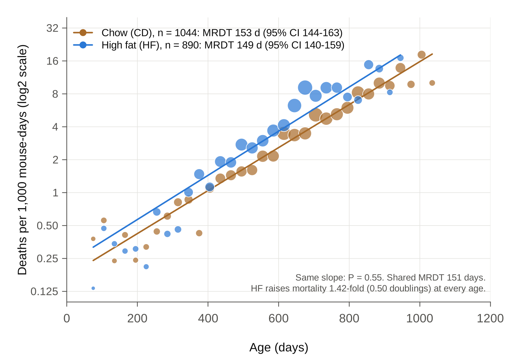

**Fig. 1 | Pooled over strains, a high-fat diet raises mortality at every age without changing the mortality rate doubling time.** Mortality rates of BXD-family females fed chow (CD, brown; *n* = 1,044 mice of 119 genotypes) or a high-fat diet (HF, blue; *n* = 890 mice of 103 genotypes), as a function of age. Genotypes are 120 BXD strains, the parental strains C57BL/6J and DBA/2J, and the reciprocal F1 hybrids B6D2F1 and D2B6F1. Points show occurrence/exposure rates in 30-day intervals, in deaths per 1,000 mouse-days at risk, with each mouse at risk from its age at set-up (left truncation). Intervals with at least 20 mice at risk are shown; point diameter scales with the square root of the number of deaths. Lines show maximum-likelihood Gompertz fits, h(*t*) = *R*0 · 2^(*t* / MRDT), drawn over the ages covered by the data. The *y* axis is log2-scaled, so each gridline marks one doubling of mortality. The key gives each diet's mortality rate doubling time (MRDT) with its 95% Wald confidence interval (CI). The slopes do not differ (likelihood-ratio test, *χ*² = 0.36, 1 d.f., *P* = 0.55). With a shared slope (MRDT 151 days), HF mortality is 1.42-fold that of CD (95% CI 1.29–1.55; likelihood-ratio test of equal levels, *χ*² = 56, 1 d.f., *P* = 7 × 10⁻¹⁴), that is, 0.50 doublings higher at every age. All mice died; none are censored. Mice are treated here as independent; Fig. 5 analyses the diet effect within strains, where high fat also shortens the MRDT (117 against 91 days; Fig. 15d).

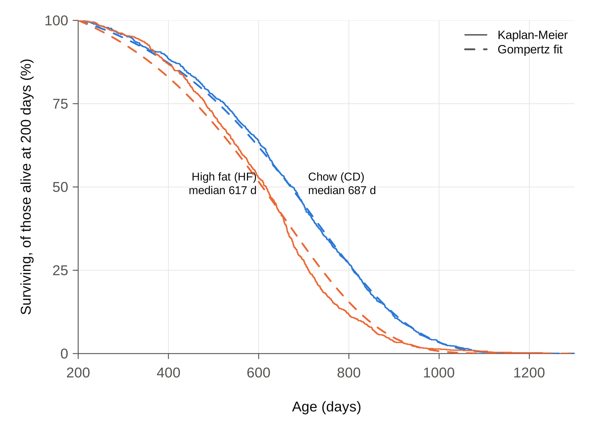

**Fig. 2 | Survival and actuarial survivorships by diet.** **a**, Kaplan–Meier survival of mice alive at 200 days (CD, *n* = 1,018; HF, *n* = 865), each at risk from the later of its set-up age and 200 days. Dashed lines show survival predicted by the Gompertz fits of Fig. 1, conditional on survival to 200 days; median ages at death are given for each diet. **b**, Mean age at death of each diet's survivorship relative to both diets combined, as a function of the minimum inclusion age (T-age), in 15-day steps, as in Arends et al. 2026, Fig. 1b. Each survivorship includes the mice alive and under observation at that T-age. Lines indicate means and shaded bands represent s.e.m. Lines end where either diet falls below 20 mice (T935); numbers at the top give the mice alive (CD / HF). HF survivors die 65–69 days earlier than CD survivors up to T400. The difference narrows between T650 and T850, faster than the Gompertz fits predict, and reverses after T860, when few HF mice remain.

## Checks

| Analysis | Chow MRDT (95% CI) | High-fat MRDT (95% CI) | Equal slopes, P |
|---|---|---|---|
| Primary | 153 (144–163) | 149 (140–159) | 0.55 |
| Mice that survived to 200 d | 152 (142–163) | 152 (142–163) | 0.99 |
| Mice that survived to 365 d | 155 (142–168) | 177 (160–196) | 0.035 |
| BXD strains only | 156 (146–167) | 149 (139–159) | 0.31 |
| Binned regression from 200 d (de Magalhães et al. 2018) | 152 (143–162) | 144 (127–167) | – |

- **Early deaths do not drive the result.** Dropping deaths before 200 days leaves the two MRDTs identical.
- **One check disagrees.** Among mice that survived past a year, high fat has a *flatter* rise (MRDT 177 days, P = 0.035). It is one nominal result among four tests, uncorrected, so it is a lead, not a finding. A likely reason is the mixture effect of primer point 8: high fat removes frail mice sooner, which flattens the late part of its curve.
- **A Makeham term is not needed.** Adding a constant term to the mortality rate (Gompertz–Makeham) leaves the MRDTs unchanged; the constant comes out near zero.
- **Resampling tells the same story** (Fig. 4). Across 2,000 bootstrap resamples, the distributions of the two diets' MRDTs overlap almost completely, while those of their levels at 600 days do not overlap at all.

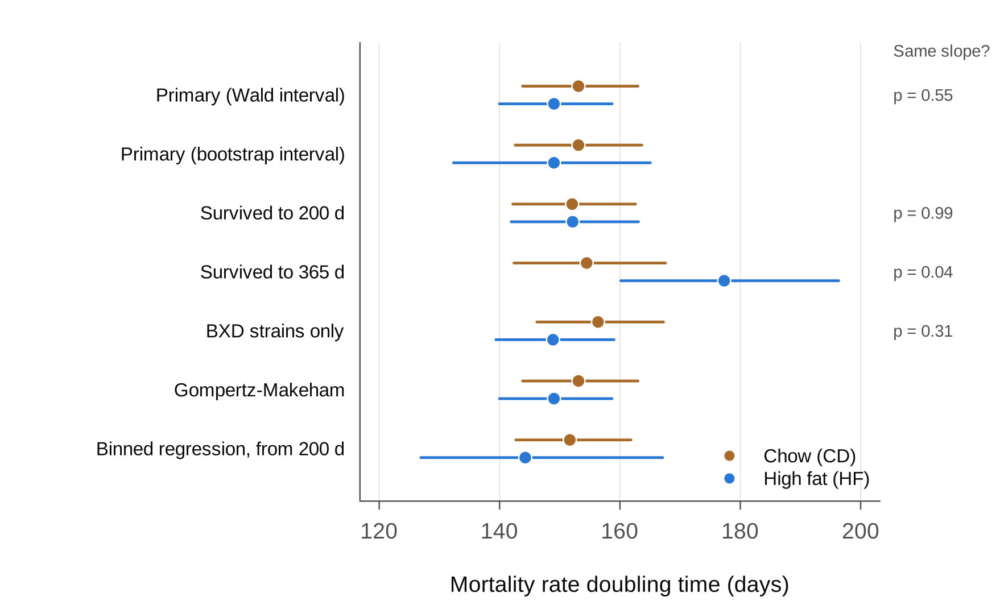

**Fig. 3 | Estimates of the mortality rate doubling time are robust to analytical choices.** MRDT (days) for CD (brown) and HF (blue) in the primary analysis (*n* = 1,044 and 890; Wald and bootstrap intervals) and in five alternatives: mice surviving to 200 days (1,018 and 865) or to 365 days (944 and 792), each at risk from that age; BXD strains only (929 and 818); a Gompertz–Makeham fit; and the binned regression of de Magalhães et al. from 200 days. Points indicate estimates and bars indicate 95% CI: Wald intervals on the log scale of the slope, except in the bootstrap row (2.5th–97.5th percentiles of 2,000 resamples) and the binned-regression row (regression standard error). *P* values at right are from likelihood-ratio tests of equal slopes (1 d.f.). Only the mice surviving to 365 days give a nominally different slope (*χ*² = 4.4, *P* = 0.035, not corrected for the four tests); in that subset HF has the flatter rise. The Makeham constant is estimated near zero on both diets.

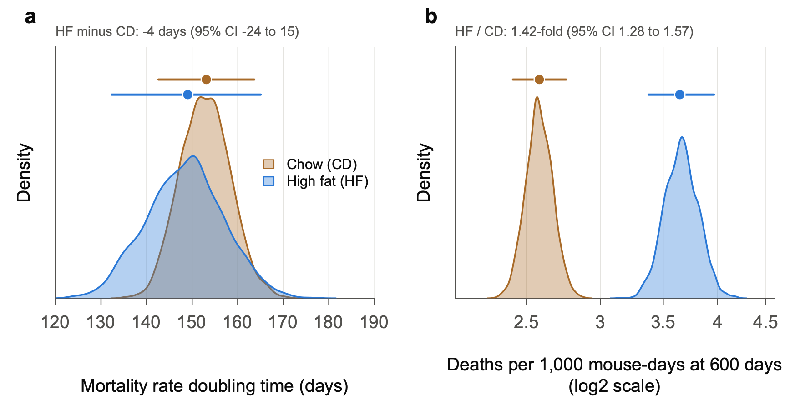

**Fig. 4 | Pooled over strains, resampling shows that the diets differ in the level of mortality, not in its doubling time.** **a**, Distributions of the MRDT across 2,000 bootstrap resamples per diet (mice resampled with replacement within diet; fixed seed), each fitted by maximum likelihood as in Fig. 1. **b**, Distributions of the mortality rate at 600 days, in deaths per 1,000 mouse-days (log2 scale), from the same resamples. Shaded curves are kernel density estimates. Points above the curves indicate full-data estimates and bars indicate 95% CI (2.5th–97.5th percentiles of the resamples). The MRDT distributions overlap almost completely: HF minus CD is −4 days (95% CI −24 to 15). The level distributions do not overlap: HF raises mortality at 600 days 1.42-fold (95% CI 1.28–1.57). The level is reported at 600 days, a typical age at death, rather than as *R*0, the rate extrapolated to birth. Across resamples, estimates of *R*0 and MRDT are tightly correlated (*r* = 0.95 for CD, 0.97 for HF; the same trade-off contributes to the Strehler–Mildvan correlation across populations), so *R*0 changes whenever MRDT does. The level at 600 days is much less tied to MRDT (*r* = 0.19 and −0.64).

## The diet effect strain by strain (exploratory)

These analyses were added after the results above were seen (`Gompertz/Diet_by_strain.R`).

- **Within strains, high fat raises mortality about 1.8-fold, not 1.4-fold** (Fig. 5b).
  - A Cox model stratified by strain gives 1.78 (95% CI 1.61–1.98). A Gompertz fit with a level for each strain gives 1.76 (1.60–1.95).
  - The pooled estimate is smaller because pooling mixes strains whose mortality levels differ (primer point 8).
  - The within-strain ratio is close to the 2.0 that Roy et al. (2021) report with strain as a random effect.
- **With one MRDT for both diets, the MRDT within strains is 113 days** (95% CI 108–117), against 151 days pooled. The pooled MRDT is that of a mixture.
- **Why the interval of the within-strain ratio is narrow:** Each strain's own ratio is noisy, but the stratified estimate combines within-strain comparisons from 98 strains and about 1,900 mice.
- **Strains differ in how much high fat harms them** (Fig. 5a).
  - Among the 76 genotypes with at least 5 mice per diet, the ratios spread more than chance allows (P = 0.0002). Within strain × vivarium strata, the same test gives P = 0.004.
  - The between-strain standard deviation of the natural-log ratio is 0.36. So about 95% of strains would have true ratios between 0.9 and 3.8.
- **Single-strain ratios are imprecise.**
  - With 8–15 mice per diet, a strain's ratio must lie more than about 2- to 2.7-fold from the common ratio to stand out at P < 0.05.
  - Only the largest groups do better: C57BL/6J (61 mice) and DBA/2J (74) resolve about 1.7-fold.
  - Eight genotypes depart from the common ratio at nominal P < 0.05, against 3.8 expected by chance.
  - **For single strains, use the shrunken estimates** in `output/Diet_by_strain.txt`. They pull each strain's ratio toward the common ratio, the more so the noisier its estimate.
- **A lead: the mother's strain**
  - High fat raises mortality 2.2-fold in C57BL/6J but not detectably in DBA/2J (1.00; P = 0.04 for the difference).
  - The reciprocal F1s follow their mothers: 2.5-fold in B6D2F1 (B6 mother) and 0.55-fold in D2B6F1 (D2 mother; P = 0.02 for the difference).
  - The two F1s carry the same nuclear genome, so a maternal, mitochondrial or parent-of-origin (imprinting) effect is possible.
  - The numbers are small (17–35 mice per F1 type) and the P values uncorrected, so this is a lead, not a finding.

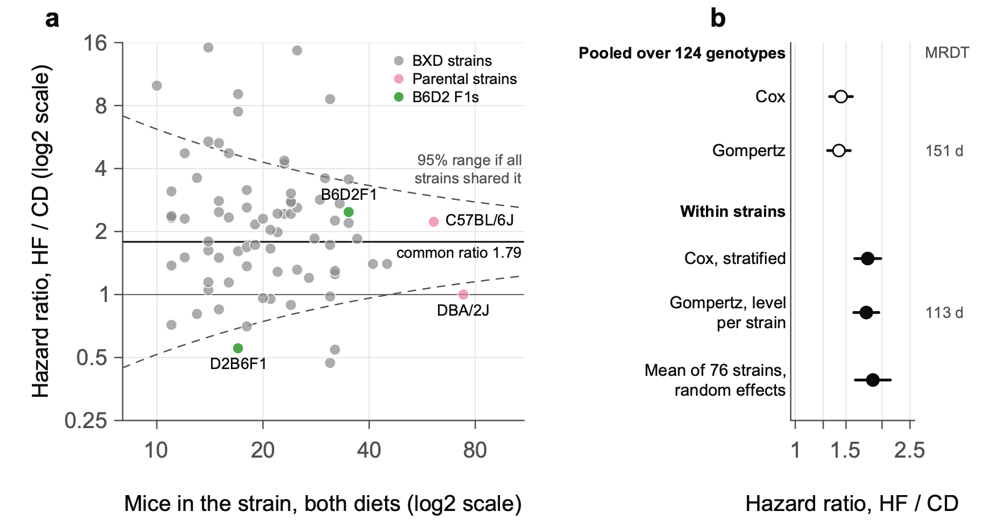

**Fig. 5 | Within strains, a high-fat diet raises mortality about 1.8-fold, and strains differ in how much.** **a**, Hazard ratio, HF / CD, in each of the 76 genotypes with at least 5 mice on each diet (*n* = 1,725 mice; 10–74 per genotype), plotted against the number of mice in the genotype. Ratios come from Cox proportional-hazards models fitted separately within each genotype, with each mouse at risk from its age at set-up. Both axes are log2-scaled. BXD strains are grey, the parental strains pink and the reciprocal F1 hybrids green. The solid line marks the common ratio (inverse-variance-weighted mean of the log hazard ratios, 1.79) and the thin line marks no effect. Dashed curves mark the approximate 95% range expected if every genotype shared the common ratio: ±1.96 × 2 / √*n* on the natural-log scale, for equal numbers on the two diets. Genotypes differ more than chance allows (diet × strain likelihood-ratio test in a strain-stratified Cox model, *χ*² = 127.0, 75 d.f., *P* = 1.7 × 10⁻⁴). The difference persists within strain × vivarium strata (*P* = 0.004). The between-strain standard deviation of the natural-log hazard ratio is 0.36 (DerSimonian–Laird; *I*² = 35%). Eight genotypes depart from the common ratio at nominal *P* < 0.05, against 3.8 expected by chance. C57BL/6J (2.23) and DBA/2J (1.00) differ (*P* = 0.04), as do the reciprocal F1s B6D2F1 (2.48) and D2B6F1 (0.55; *P* = 0.02); *P* values are uncorrected. **b**, The diet hazard ratio estimated five ways. Open points are pooled over all 124 genotypes: Cox, and Gompertz with a shared MRDT (as in Fig. 1). Filled points are within strains: Cox stratified by strain (98 genotypes on both diets); Gompertz with a level for each genotype and one MRDT; and the random-effects mean of the 76 estimates in **a**. Points indicate estimates and bars indicate 95% CI. The MRDT is given at right: 151 days pooled, against 113 days (95% CI 108–117) within strains. Exploratory: added after the results of Figs 1–4 were seen.

## Within strains, high fat also steepens the rise of mortality (exploratory, new in version 2)

The steeper rise was found on 27 October 2026, during the rectangularization comparison of Part 5 (`Gompertz/Rectangularization.R`), after all the results above were seen.

- **The fit:** Each strain × diet cell gets its own level, and each diet its own MRDT. The fit uses the 76 genotypes with at least 5 mice on each diet (916 chow and 809 high-fat mice).
- **The result:** The MRDT is 117 days on chow and 91 days on high fat.
  - The ratio is 0.78 (95% CI 0.69–0.88, delete-one-strain jackknife).
  - Animal-level likelihood-ratio test: χ² = 30.3, 1 d.f., P = 4 × 10⁻⁸.
- **What it means:** Within a strain, high fat both raises mortality and tilts the line. In this fit the high-fat multiple grows with age: about 1.4-fold at 400 days, 1.9-fold at 600 days and 2.7-fold at 800 days.
- **The spread of ages at death agrees.** Within strains, the standard deviation of age at death is 0.80 times as large on high fat (P = 0.0001). Under the Gompertz law, the spread of ages at death is roughly proportional to the MRDT, and 0.80 is close to the MRDT ratio of 0.78.
- **Checks**
  - **Genotypes with more mice give the same ratio:** 0.75 with at least 10 mice on each diet (34 genotypes), and 0.76 with at least 15 (14 genotypes).
  - **Small cells do not create the shorter high-fat MRDT.** In 40 simulations in which both diets share one MRDT, with our strains, cell sizes and set-up ages, the fitted ratio averaged 0.99.

**Why pooling hides the steeper rise (primer point 8)**
- In a pooled curve, mice of the frailest strains die first, so the survivors at late ages come mostly from hardy strains. That flattens the pooled curve.
- Strains differ more on high fat, because they differ in how much high fat harms them (Fig. 5a). In this fit, the standard deviation of the strains' levels at 600 days is 1.41 doublings on high fat, against 1.06 on chow; part of each is noise.
- So pooling probably flattens the high-fat curve more than the chow curve. The extra flattening would offset the steeper rise within strains, leaving the pooled MRDTs nearly equal.
- The check restricted to mice alive at one year gave high fat a *flatter* rise (177 days). That is probably the same mixture effect, strongest among the survivors.

**Part 1 in brief**
- **Pooled over the BXD family,** high fat raises mortality by about the same multiple at every age.
- **Within a strain,** high fat both raises the level of mortality and steepens its rise.

The estimates are shown in Fig. 15d (Part 5).

## Things to keep in mind

- **The MRDTs in Figs 1–4 are those of a mixture of 124 genotypes:** 120 BXD strains, the two parental strains and the two reciprocal B6D2 F1s. The BXD × BXD F1 hybrids of Part 2 are not included. Within strains the MRDT is 113 days when both diets share one MRDT (Fig. 5b), or 117 days on chow and 91 days on high fat when each diet has its own.
- **Vivarium and cohort are not adjusted for in Figs 1–4.** Most genotypes (98 of 124) have mice on both diets, though not in equal numbers. Stratifying by strain and vivarium leaves the within-strain ratio unchanged (1.85 in the 76 genotypes of Fig. 5a).

---

# Part 2: Does genotype change the mortality rate doubling time? BXD proximal Chr 1 and F1 hybrids

## The plan, fixed before any fit

Two tests were written into an analysis plan and committed before any fit was made (`notes/PREREGISTRATION_secondary.md`, 24 October 2026). Claude wrote the plan. Its amendments record what Rob did and did not agree to.
- **H1, proximal Chr 1:** BXD strains with D across proximal Chr 1 (3–30 Mb, covering Vita1a and nearly all of Vita1b) against strains with B across it. Two-tailed: Rob had no prediction about the direction of any change in MRDT.
- **H2, F1 hybrids:** BXD × BXD F1 hybrids against their inbred parents.
  - **Rob's question,** before the plan was written: "Does being an F1 flatten the MRDT. For me this is a pre-registered one-tailed test."
  - **Claude read "flatten" as a longer MRDT** and tested that direction.
  - **Rob's prediction, as he stated after the results:** "I was guessing that F1 hybrids would be more vigorous and more buffered to the hard knocks of being a mouse born into a vivarium from the moment of birth and throughout life. Full stop. This is not a rate of change assertion."
  - **So Rob's prediction was about level:** F1 mortality lower at every age.

Each test fits one MRDT per group, shared by both diets, and a separate level for each group and diet. Only mice alive at 200 days enter, each at risk from the later of its set-up age and 200 days. Uncertainty comes from a delete-one-genotype jackknife (one strain or F1 type at a time).

## Results

| Test | MRDT, first group | MRDT, second group | Ratio (95% CI) | P |
|---|---|---|---|---|
| H1: D strains / B strains | B: 141 d | D: 154 d | 1.10 (0.80–1.51) | 0.57, two-tailed |
| H2: F1 hybrids / inbred parents | Parents: 165 d | F1: 107 d | 0.65 (0.43–0.97) | 0.98, one-tailed for a longer F1 MRDT |

**H1: Proximal Chr 1 changes the level of mortality; no change in MRDT is detected.**
- **Level, on high fat:** At 600 days, B strains die at about twice the rate of D strains: 5.8 against 2.8 per 1,000 mouse-days.
- **Level, on chow:** 3.1 against 2.5, a ratio of 1.25.
- **The D haplotype nearly cancels the high-fat penalty.** High fat raises mortality at 600 days 1.86-fold in B strains but only 1.15-fold in D strains. This matches the diet-dependent effect of Vita1a and Vita1b on lifespan, and the cancellation is a level effect (descriptive, from the fitted levels; not a registered test).

**H2: The F1 MRDT is shorter, not longer.**
- **The registered direction is not supported.** Under the plan, the opposite direction is reported as an estimate, not a discovery.
- **Rob's prediction holds in the crosses between short-lived strains, until old age.** These crosses also carry the shorter F1 MRDT:

| Comparison | Parents | F1s | Ratio of MRDTs (95% CI) |
|---|---|---|---|
| Short × short F1s / short-lived parents (BXD9, 170, 172, 197) | 156 d | 98 d | 0.63 (0.49–0.81) |
| Long × long F1s / long-lived parents (BXD65, 73b, 77, 102) | 110 d | 105 d | 0.95 (0.72–1.27) |
| B6D2F1 and D2B6F1 / C57BL/6J and DBA/2J | 116 d | 134 d | 1.15 (0.86–1.55) |

- **The short × short F1s start far lower.** At 600 days on chow they die at a quarter of their parents' rate: 1.4 against 5.4 per 1,000 mouse-days.
- **Their mortality then rises faster.** The curves would meet near 1,100 days on chow and near 950 days on high fat. So these hybrids gain most in early and middle adult life, and the gain narrows with age.

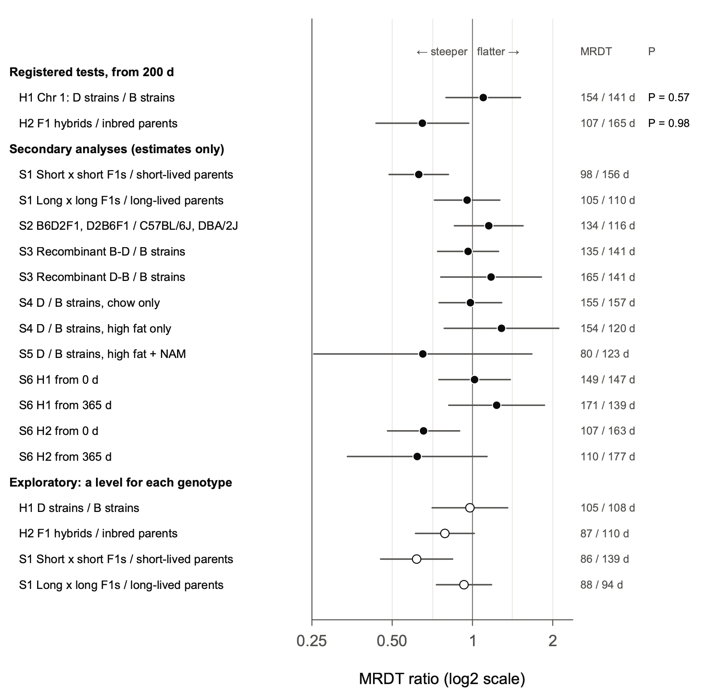

**Fig. 6 | The F1 hybrids of short-lived BXD strains have a shorter mortality rate doubling time than their parents; the proximal Chr 1 haplotype does not change it.** Ratio of the MRDT of the second group to that of the first (log2 scale) for each comparison; values below 1 mean a steeper rise of mortality with age in the second group. The MRDTs (second / first, days) are given at right. Females surviving to 200 days, each at risk from the later of its set-up age and 200 days. Each group has one MRDT, shared by its diets, and each group × diet cell has its own level. Points indicate estimates. Bars indicate 95% CI from a delete-one-strain jackknife (delete one F1 type for the F1 comparisons), except for S2, which has four genotypes and uses a Wald interval. The two registered tests used *t* = log2 ratio / jackknife s.e., each at *α* = 0.025. H1, D strains / B strains across proximal Chr 1 (*n* = 459 mice of 34 strains and 483 of 33): ratio 1.10 (95% CI 0.80–1.51), *t* = 0.58, 66 d.f., two-sided *P* = 0.57. H2, F1 hybrids / inbred parents (*n* = 320 mice of 13 F1 types and 218 of 8 strains): ratio 0.65 (0.43–0.97), *t* = −2.26, 20 d.f., one-sided *P* = 0.98 for the registered direction, a longer F1 MRDT. Secondary analyses (S1–S6) were specified in advance and are shown as estimates only; the largest is S1, short × short F1s / short-lived parents, 0.63 (0.49–0.81). Open points are exploratory refits, made after the registered results were seen, that give each genotype × diet cell its own level.

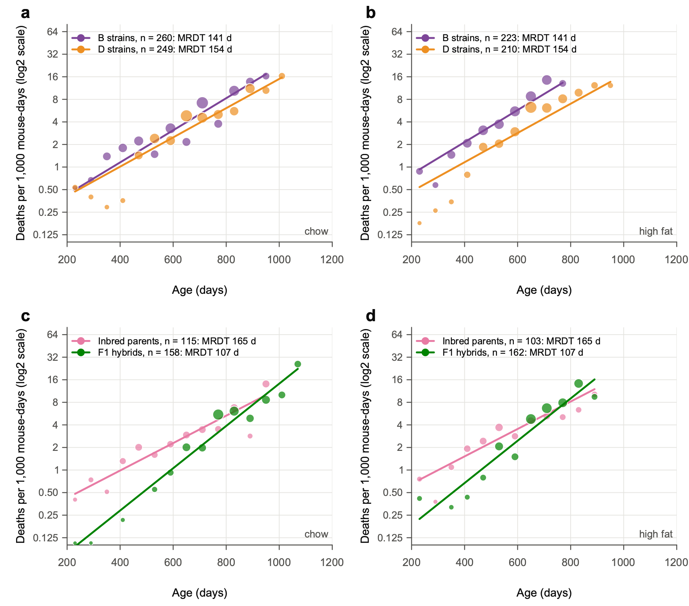

**Fig. 7 | F1 hybrids start with lower mortality and lose their advantage with age; across the Vita1a–Vita1b interval, D and B strains differ in level, not slope.** **a**,**b**, Mortality rates of BXD strains homozygous for the D haplotype (orange) or the B haplotype (purple) across the whole of proximal chromosome 1, from the first marker at 3.0 Mb to 30 Mb, on chow (**a**) and high fat (**b**). This interval spans Vita1a and Vita1b of Arends et al. 2026. Haplotypes were called from sequence-based BXD genotypes (441 markers in the interval). Strains with a recombination in the interval (48 in these data) or with a heterozygous block are excluded. *n* = 459 females of 34 D strains and 483 of 33 B strains alive at 200 days. **c**,**d**, Mortality rates of 13 types of BXD × BXD F1 hybrid (green; *n* = 320) and their 8 inbred parental strains (pink; *n* = 218) on chow (**c**) and high fat (**d**). Points show occurrence/exposure rates in 60-day intervals, in deaths per 1,000 mouse-days at risk, where at least 10 mice were at risk; point diameter scales with the square root of the number of deaths. Lines show the registered model, fitted by maximum likelihood from 200 days and drawn over the ages covered by the data: one MRDT per group, shared by both diets, and a level for each group × diet cell. The *y* axis is log2-scaled. *n* in the keys is the number of females alive at 200 days. The registered tests are given in Fig. 6 (H1, *P* = 0.57; H2, *P* = 0.98). At 600 days on high fat, B strains die at 5.8 and D strains at 2.8 per 1,000 mouse-days; on chow, at 3.1 and 2.5. On chow at 600 days, short × short F1s die at a quarter of their parents' rate (1.4 against 5.4).

## Exploratory checks, added after the registered results were seen

- **A level for each genotype:** The registered model pools genotypes with different levels, which flattens a group's curve (primer point 8). Giving each genotype × diet its own level:
  - halves the F1 shortening of the MRDT on a log scale (ratio 0.79, 95% CI 0.61–1.02, which now includes 1);
  - leaves the short × short steepening unchanged (0.62, 0.45–0.84);
  - leaves the H1 ratio near 1 (0.98);
  - gives MRDTs within genotypes of mostly 86–110 days.
- **Gamma-Gompertz:** This model lets mice within a group differ in frailty, a multiple of risk that each mouse carries for life. The B strains and the inbred parents need no frailty term; the D strains and the F1s do. With that term, the H1 estimate reverses sign: the D strains' MRDT becomes shorter than the B strains'. Together with the per-genotype refit, this leaves no consistent evidence that proximal Chr 1 changes the MRDT.

## A model: how many genes make the F1 difference?

This is a model, not an analysis of data. It asks Sewall Wright's question of the F1 experiment: do a few or many recessive loci explain the hybrids' gains?
- **The setup:** Harmful alleles segregate at 10 or 200 loci, and each inbred strain is homozygous for the harmful allele at about half of them, its "load". An F1 expresses a harmful recessive only where both parents carry it.
- **Two ways for load to act:**
  - **multiply:** Load multiplies the Gompertz hazard, so it changes the level only;
  - **add:** Load adds deaths of its own that rise slowly with age.
- **What the model shows** (Fig. 8):
  - **How load acts sets which F1s gain more.** Under "add", hybrids of short-lived strains gain more than hybrids of long-lived strains; under "multiply", the reverse.
  - **The number of loci sets how large the gains are.** With 200 loci, F1s would gain 550–1,000 days over the mid-parent (159 days for long × long under "add"), far more than observed.
  - **The data are closest to a few effective factors, with load adding its own deaths.** Observed gains over the mid-parent are 178 days for short × short F1s and 32 days for long × long. The "add" model with 10 loci predicts 177 and 121 days: close for short × short, too high for long × long.
- **Why the F1 rise is steeper:** In this model, a short-lived inbred strain has a long MRDT because its extra deaths from load rise slowly with age. Its long MRDT reflects load, not a slower rise of the underlying Gompertz mortality. Masking the load in the F1 leaves the steeper underlying rise, as observed in the short × short crosses.

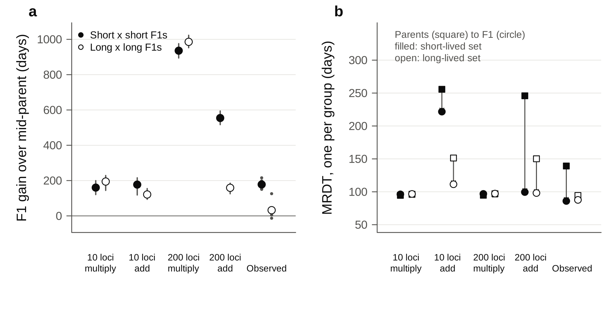

**Fig. 8 | A few effective factors, with load that adds its own deaths, reproduce the gains of short × short F1s and the direction of their steeper rise of mortality.** Simulated BXD strains carry 10 or 200 recessive loci. Load either multiplies the Gompertz hazard ("multiply") or adds a hazard of its own that doubles every 300 days ("add"). Each model is calibrated so that inbred strains live 400–950 days. **a**, Gain in mean age at death of F1s over the mean of their two parents (days), for short × short (filled) and long × long (open) crosses. Points indicate medians and bars indicate the 10th–90th percentiles of 200 simulated experiments (fixed seed). At right are the observed gains of the 13 F1 types, each shown as a small point. **b**, MRDT of parents (squares) and F1s (circles), one per group, for the short-lived (filled) and long-lived (open) sets. Exploratory model, not a fit to the data.

## In plain words

- **Proximal Chr 1** changes *how many* BXD mice die at a given age, especially on high fat, with no detectable change in *how fast* their risk doubles.
- **Crossing two short-lived BXD strains** gives hybrids that are much less likely to die in early and middle adult life. Their risk then climbs faster, so by very old ages they lose much of their advantage.

---

# Part 3: Vita1a and Vita1b in UM-HET3 mice

## 3.1 Why look at UM-HET3 mice

- **Arends et al. 2026** mapped 29 lifespan loci (Vita loci) in 6,438 genotyped UM-HET3 mice. Two of them lie on proximal Chr 1:
  - **Vita1a,** 3.0–8.0 Mb, peak at 3.0 Mb (marker 1_3010274), with its highest LOD score in the T860 survivorship (mice alive at 860 days);
  - **Vita1b,** 16.0–31.1 Mb, peak at 24.0 Mb (marker 1_24042124), with its highest LOD at T695.
- **The two loci overlap the region of the BXD Chr 1 test (H1, 3–30 Mb).** So we asked of the UM-HET3 mice the question we asked of the BXDs: does proximal Chr 1 change the level of mortality, its MRDT, or both?
- **Arends et al. describe Vita1a and Vita1b as "durable, late" loci.** The loci's effects on life expectancy are stable from T42 to about T890, but their effects on mortality are concentrated late in life (Arends et al. Fig. 1h,i and Table 1).

**UM-HET3 genetics in brief**
- **Mothers** are CByB6F1 (BALB/cByJ × C57BL/6J), so each mouse inherits a maternal **C** or **B** haplotype.
- **Fathers** are C3D2F1 (C3H/HeJ × DBA/2J), so each mouse inherits a paternal **H** or **D** haplotype.
- **That gives four genotypes at every locus:** CH, CD, BH and BD, expected in equal numbers.
- **Every UM-HET3 mouse carries two different founder haplotypes at every locus.** The B and D haplotypes are the same as in the BXDs, but B comes only from mothers and D only from fathers. So the UM-HET3 contrast that involves D is **D against H** (DBA/2 against C3H), not D against B.

## 3.2 Data

- **Supplementary Table 2 of Arends et al.:** deaths per 15-day window and numbers alive by genotype, for each Vita locus, for females, males and both sexes. In the published files the first column has no header. Clean copies with that header added, each checked for internal consistency, are in `data/umhet3/Table2/`.
  - **The checks:** Columns add up; numbers alive fall by exactly the deaths; female + male = combined. All 87 files pass.
- **The Vita1a block of Rob's expanded Table 1** (sheet Table_1f) is Table 2's both-sexes file. Its columns run CH, CD, BH, BD, but the sheet labels them CH, BH, BD, CD.
- **Individual mice** (Supplementary Table 7, the R/qtl file used for mapping): age at death, sex, site, cohort, drug group and every marker call. We used this file to check the genotype calls and to refit by site and cohort.

## 3.3 Problems with the haplotypes and genotypes

### What we expected and what we found

- **Expected:** paternal H and D in equal numbers at every locus. Each father passes on his C3H or his DBA/2 copy with a probability of one half.
- **Found:** At Vita1a and Vita1b, Table 2 has about twice as many paternal H as paternal D.

| Locus | Paternal H : D | Maternal C : B | Mice with a call, of 6,438 |
|---|---|---|---|
| Vita1a | 2.02 | 0.96 | 3,133 |
| Vita1b | 1.91 | 0.95 | 5,174 |
| Vita1d | 1.39 | 0.98 | 4,764 |
| Vita1c | 1.15 | 1.04 | 5,485 |
| 25 loci off Chr 1 | 0.91–1.11 | 0.88–1.07 | 2,753–6,319 |

The excess is paternal only, on Chr 1 only, and in both sexes.

### How a genotype is called in a four-way cross

- **Most markers report only one parent.** At most SNPs, the two maternal strains (BALB/cByJ and C57BL/6J) carry the same allele, so the SNP can tell only which haplotype came from the father. At other SNPs it is the reverse.
- **R/qtl codes each call accordingly:** 7 = father H, 8 = father D, 5 = mother C, 6 = mother B, with codes 1–4 for the rare full calls.
- **We confirmed the codes on the X chromosome.** Every daughter receives her father's X, and a C3D2F1 father's X comes from his C3H mother. On the X chromosome, females carry only "father H" codes.
- **The genotype at a Vita peak is inferred** from the nearest markers that report the father and the nearest that report the mother.

### Evidence that the excess is a genotyping error (Fig. 9)

1. **Two SNPs 2 bp apart give different fractions of H.** At 3.01 Mb, 1_3010272 gives 42% H and 1_3010274 gives 71% H. Recombination between them is practically impossible, so the difference must come from which mice each SNP calls.
   - In the 741 mice called at both SNPs, the two agree in every mouse (42% H).
   - All of the excess comes from 1,825 mice called only at 1_3010274, which are 82% H.
   - The same holds at 31.06 Mb, for two SNPs 21 bp apart: in mice called at both, 52% H; in the 3,238 called only at 1_31062737, 74% H.
2. **The error is confined to two sites.**
   - At **JL** (Jackson Laboratory) every proximal Chr 1 marker gives 48–52% H.
   - At **UM** (Michigan) and **UT** (UT Health San Antonio), 1_3010274 gives 77% and 70% H, and 1_31062737 gives 73% and 75%.
   - The cause is the marker set rather than the site itself: one of the two MonsterPlex marker sets of Arends et al., used for all UT mice and about half of the UM mice, loses heterozygous calls (Fig. 9). UT mice have no call at 4.34 Mb at all.
3. **The Vita1b error depends on the mother's haplotype.** At UM and UT, when the mother's haplotype at 24 Mb is B, the 31.06 Mb marker calls the father H in 94% (UM) and 99% (UT) of mice. When the mother's haplotype is C, it does so in 51%.
   - A distortion in the fathers' transmission could not depend on the mother's allele.
   - BD at this locus is not lethal in itself: B6D2F1 hybrids are B/D at every locus and live long.
   - **So at UM and UT, true BD mice are called BH.** This is the "BD-only" deficit at Vita1b.
4. **There is a hole in the map.** No marker reports the father's haplotype between 4.3 and 31.1 Mb. So the paternal call at the Vita1b peak (24 Mb) must be inferred from the faulty 31.06 Mb marker. This is the map problem "right after Vita1b" that Rob recalled.

**The likely mechanism** is heterozygous calls lost to allele dropout. At these SNPs the C3H allele matches the mothers' allele, so a paternal-D mouse is heterozygous. If its DBA/2 allele is not seen, it looks homozygous and is called "father H".

**Two consequences for any analysis of Vita1a and Vita1b**
- **Misclassification:** Many D mice sit in the "H" group, which dilutes any genotype difference.
- **Composition:** The miscalls cluster by site and cohort. The "H" group is therefore enriched for UM and UT mice and for particular cohorts, and sites and cohorts differ in lifespan. Any genotype comparison that pools sites can mix in site and cohort effects.

**Lessons for the new low-pass sequencing (1–3X, Ultima Genomics)**
- **Low depth will under-call heterozygotes at single SNPs.** That is the failure seen here at a few SNPs, spread across the genome. Calls should come from haplotype-aware imputation across many SNPs, not from single SNPs.
- **Two routine checks:**
  - the paternal and the maternal ratio along every chromosome, by site and by batch, which should be 1:1;
  - the fraction of heterozygous calls at each SNP.
- **The JL mice are a natural benchmark,** because their MonsterPlex calls on proximal Chr 1 look clean.

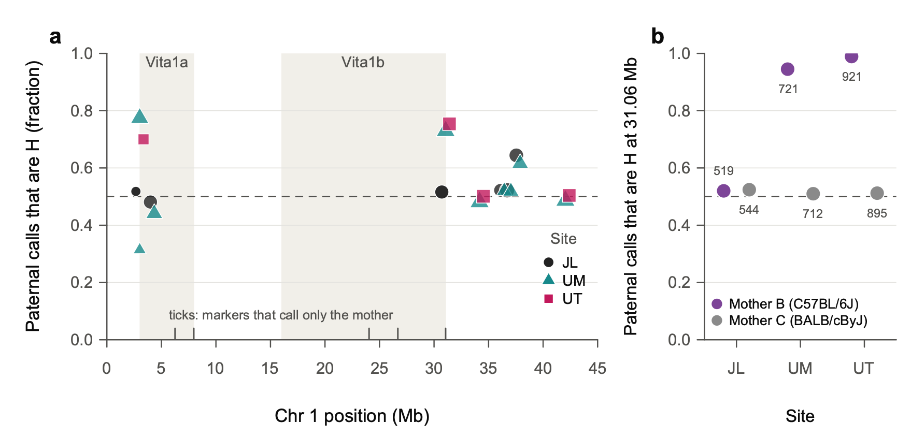

**Fig. 9 | Paternal genotype calls on proximal Chr 1 are biased towards H at two of the three sites.** **a**, Fraction of paternal calls that are H (C3H/HeJ) rather than D (DBA/2J) at each proximal Chr 1 marker that reports the father's haplotype, by site: JL, Jackson Laboratory (circles); UM, University of Michigan (triangles); UT, UT Health San Antonio (squares). Point area scales with the number of calls. Shaded bands mark the Vita1a and Vita1b intervals of Arends et al. 2026; ticks at the bottom mark markers that report only the mother's haplotype. The dashed line marks the expected 0.5. **b**, Fraction of paternal calls that are H at 1_31062737 (31.06 Mb) by site, for mice whose maternal haplotype at 1_24042124 (24.0 Mb) is B (purple) or C (grey). Numbers give mice called at both markers. The bias follows the genotyping marker set rather than the site. Arends et al. Supplementary Table 5 holds two MonsterPlex marker sets. All JL mice were genotyped with one set, and the other set was used for 1,497 of 2,750 UM mice and all 1,883 UT mice. That second set loses heterozygous calls at 11 incidental SNPs, including 1_3010274 and 1_31062737 (`UMHET3/vcf_set_check.R`). Data: 6,438 mice of Arends et al. Supplementary Table 7.

## 3.4 Initial findings

### Using the published Table 2

Each sex gets its own curves, because male and female MRDTs differ greatly.
- **Males against females:** Male mortality is higher than female mortality in mid-life (about 1.1 against 0.55 deaths per 1,000 mouse-days at 600 days). It doubles more slowly (MRDT about 155 against 100 days), so the sexes converge by about 860 days.
- **Why separate curves:** Pooling the sexes mixes two different curves and overstates the genotype effect on MRDT (P = 0.005 pooled).

From 200 days of age:

| Contrast | Sex | MRDT, D group | MRDT, other | Mortality ratio at 600 d | at 860 d |
|---|---|---|---|---|---|
| Vita1a: paternal D / H | Females | 94 d | 101 d | 1.19 | 1.36 |
| | Males | 146 d | 159 d | 1.25 | 1.38 |
| Vita1b: BD / CH, CD, BH | Females | 97 d | 105 d | 1.16 | 1.33 |
| | Males | 139 d | 152 d | 1.29 | 1.44 |

- **Level:** Paternal D at Vita1a, and BD at Vita1b, raise mortality about 1.2-fold at 600 days and about 1.4-fold at 860 days, in both sexes.
- **Slope:** The ratio grows with age, so the D group's MRDT is shorter. A test that lets each sex have its own curves, and asks whether D changes the slope by the same amount in both, gives P = 0.041 for Vita1a and P = 0.046 for Vita1b. The slope change does not differ between the sexes (P = 0.8).
- **These are not two independent results.** The loci are 20 Mb apart on one chromosome and share the faulty markers.

### Checking the result within sites and cohorts (exploratory)

We refitted from individual mice, using each mouse's raw marker calls, by maximum likelihood. Each site × cohort has its own level, so genotypes are compared within cohorts.

| Vita1a, paternal D / H | Sex | n, H / D | MRDT, H / D | Ratio at 600 d | at 860 d | Equal slopes, P |
|---|---|---|---|---|---|---|
| JL (clean calls) | Females | 274 / 343 | 88 / 105 d | 1.29 | 0.92 | 0.007 |
| | Males | 414 / 385 | 140 / 134 d | 0.97 | 1.03 | 0.48 |
| UM + UT (biased calls) | Females | 775 / 419 | 104 / 99 d | 1.22 | 1.33 | 0.31 |
| | Males | 1,006 / 442 | 144 / 132 d | 1.17 | 1.31 | 0.13 |
| All three sites | Both sexes | | | 1.10–1.22 | 1.18–1.21 | 0.22 (2 d.f.) |

- **At JL, paternal H is not in excess** (D is 56% of females and 48% of males). The H excess is absent where the genotyping is clean, although the D excess in JL females (343 against 274) is itself more than chance allows (binomial P = 0.006).
- **The level effect of paternal D survives.** Within cohorts, paternal D raises mortality about 1.2-fold at 600 days at UM and UT, in both sexes, and 1.3-fold in JL females; JL males show no effect (0.97).
- **The shorter D MRDT does not survive.**
  - At UM and UT the D group's MRDT is a little shorter, but not significantly.
  - At JL the females go the other way: D is *flatter* (MRDT 105 against 88 days, P = 0.007), so the D excess at 600 days (1.29) is gone by 860 days (0.92). JL males show no difference.
  - Across all sites, P = 0.22.
- **Vita1b cannot be judged outside JL,** because BD mice are almost never called at UM and UT. At JL, BD females have 1.36-fold mortality at 600 days and 1.14-fold at 860 days; BD males show no difference. Neither slope differs.
- **The late-life rise of the D/H ratio seen in Table 2 comes from UM and UT** (Fig. 10c, d). At JL it is not seen. We cannot yet tell whether JL simply differs, or whether the late-life pattern partly reflects the miscalls. Re-genotyped data should settle it.

**For comparison with Arends et al.:** Their Fig. 1 describes D as strongly disadvantageous before 900 days and H as disadvantageous after 1,000 days. In Table 2, the D/H ratio in both sexes combined stays above 1 until 1,100 days (1.7 at 1,000–1,100 days) and falls to 0.95 after 1,100 days, when few D mice remain.

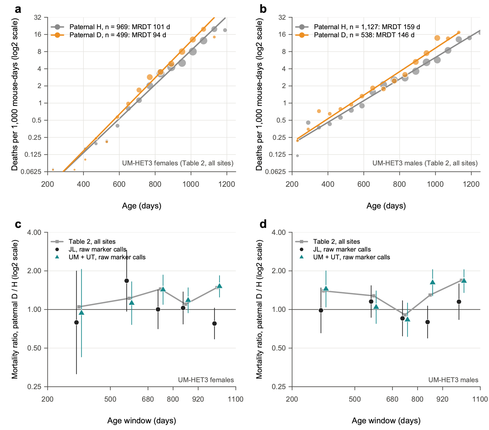

**Fig. 10 | At Vita1a, the paternal D haplotype raises mortality in both sexes; its growing effect with age is seen only at the two sites with biased calls.** **a**,**b**, Mortality rates of UM-HET3 females (**a**) and males (**b**) by paternal Vita1a haplotype, H (C3H/HeJ, grey) or D (DBA/2J, orange), from the published Supplementary Table 2 (all sites). Points show rates in 60-day intervals, in deaths per 1,000 mouse-days, where at least 20 mice were at risk; point area scales with the number of deaths. Lines show Poisson Gompertz fits from 200 days, with a level for each of the four genotypes and an MRDT for each paternal haplotype. Each line is the geometric mean of its haplotype's two genotypes. *n* is the number of mice genotyped. A slope change shared by the sexes gives *P* = 0.041 (likelihood-ratio test, 1 d.f.); the sexes do not differ in it (*P* = 0.80). **c**,**d**, Mortality ratio, paternal D / H, by age window (log2 scale), for females (**c**) and males (**d**). Grey squares and line show Table 2, all sites. The other points use individual mice and raw marker calls (1_3010272, 1_3010274 and 1_4344820, where they agree), at JL (black circles) and at UM and UT (teal triangles). Bars indicate 95% CI from the Poisson counts of deaths. Fitted to individual mice, with a level for each site × cohort, the slope change is not supported (*χ*² = 3.1, 2 d.f., *P* = 0.22). Exploratory; *P* values are not corrected for multiple tests.

## 3.5 UM-HET3 females against BXD chow females

| Females, from 200 days | BXD, chow | UM-HET3 (Table 2, all sites) |
|---|---|---|
| Contrast | D strains / B strains, proximal Chr 1 | Paternal D / H, Vita1a |
| Mice | 249 D, 260 B | 499 D, 969 H |
| MRDT | D 155 d, B 157 d | D 94 d, H 101 d |
| Mortality at 600 d, per 1,000 mouse-days | D 2.49, B 3.17 | D 0.64, H 0.53 |
| Mortality ratio at 600 d, D / other | **0.79** | **1.19** |

1. **UM-HET3 females die at a much lower rate in mid-life, but their mortality rises faster than that of the pooled BXD chow females.**
   - At 600 days their mortality is about a fifth of the BXD chow females'.
   - Their MRDT is about 100 days against 155. The curves meet near 1,000 days (Fig. 11a).
   - This is the same pattern as the BXD F1 hybrids against their inbred parents in Part 2: lower level, steeper rise. UM-HET3 mice are four-way hybrids, heterozygous almost everywhere.
   - The BXD MRDT of 155 days is that of a mixture of about 67 strains (primer point 8). Within single strains it is closer to 105 days, near the UM-HET3 value.
   - The colonies, diets and eras differ, so compare shapes more than absolute levels.
2. **The D haplotype on proximal Chr 1 has effects of opposite sign in the two populations.**
   - In BXD females, D lowers mortality relative to B (ratio at 600 days 0.79 on chow and 0.47 on high fat).
   - In UM-HET3 females, paternal D raises it relative to H (1.19).
   - **This need not be a contradiction,** because the comparisons differ: the BXD contrast is D against B, and the UM-HET3 contrast is D against H (C3H). In UM-HET3 mice the maternal B and C haplotypes do not differ in mortality (Table 2 levels: BH 0.52 against CH 0.55, BD 0.65 against CD 0.62).
   - **Two readings fit:**
     - **A protective C3H allele:** If C3H carries an allele that B6, BALB/c and DBA/2 lack, "H is good" in UM-HET3 mice and B and D do not differ at that variant. The BXD difference would then come from a different variant in the interval.
     - **Different variants within a large interval:** The BXD contrast spans 3–30 Mb, while the UM-HET3 contrast is at Vita1a (3.0–8.0 Mb). A D allele that raises mortality near Vita1a and another that lowers it elsewhere in the interval would give effects of opposite sign.
   - **The founder sequence variants can separate these readings** (Supplementary Table 17, in `data/local/`). Variants at 3–8 Mb where C3H differs from the other three founders are the candidates for the first reading.
   - The genotyping problems mean the UM-HET3 contrast itself needs confirmation.
3. **Neither population shows a convincing proximal Chr 1 effect on MRDT.**
   - BXD chow: D 155 against B 157 days (a chow-only fit, with the strain jackknife).
   - UM-HET3: the Table 2 slope signal does not survive the site and cohort check.
   - **In both populations, proximal Chr 1 affects the level of mortality, provisionally in UM-HET3 mice.**

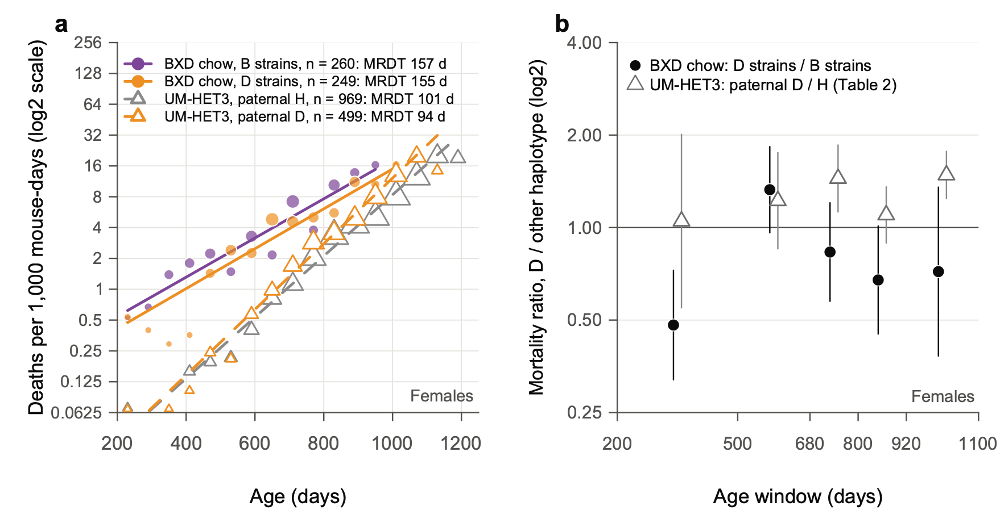

**Fig. 11 | Proximal Chr 1 acts on the level of mortality in both populations, in opposite directions for the D haplotype.** **a**, Mortality rates of BXD females on chow by proximal Chr 1 haplotype (filled circles and solid lines: B strains purple, *n* = 260; D strains orange, *n* = 249). Also shown are UM-HET3 females by paternal Vita1a haplotype (open triangles and dashed lines: H grey, *n* = 969; D orange, *n* = 499). Rates are in 60-day intervals from 200 days (log2 scale); point area scales with the number of deaths. Lines show Gompertz fits: for BXD, one MRDT per haplotype class with strains pooled (Part 2, analysis S4); for UM-HET3, as in Fig. 10a. **b**, Mortality ratio of D to the other haplotype by age window (log2 scale): BXD chow, D strains / B strains (black circles); UM-HET3, paternal D / H (open triangles; Table 2, all sites). Bars indicate 95% CI from the Poisson counts of deaths. At 600 days the ratio is 0.79 in BXD (D / B) and 1.19 in UM-HET3 (D / H). The UM-HET3 comparison is with C3H/HeJ, not C57BL/6J, so the two ratios need not agree. Exploratory.

## 3.6 What next

1. **Re-genotype proximal Chr 1** with the low-pass sequencing, using imputation and the ratio checks above. Then refit Vita1a and Vita1b by sex, site and cohort. Until then, treat the UM-HET3 Chr 1 results as provisional.
2. **Query the founder variants at Vita1a and Vita1b** (Supplementary Table 17) to test the "protective C3H allele" reading.
3. **Fit level and MRDT for all 29 Vita loci, by sex,** from Table 2, to replace the "rate of aging modulator" list. Treat the four Chr 1 loci, whose paternal H : D ratios run 1.15–2.02, as provisional.
4. **Run a Makeham check** on the short-lived BXD parents against their short × short F1s: do the parents carry extra deaths that rise little with age, as the model in Fig. 8 suggests?

---

# Part 4: Terminal weight loss and the per diem cost of late life

## Question

Do longer lives bring longer periods of decline at the end?
- **Expansion of morbidity:** Longer life adds years of poor health at the end.
- **Compression of morbidity** (Fries 1980): The decline is squeezed into a short span just before death, as survival curves become more "rectangular."

Human data are hard to read, because people differ in so many ways. Mice of fixed genotypes, on controlled diets in shared vivaria, are easier to compare.

Rob put the question as a cost to the investigator:

> "consider our mouse models as if we changed mouse per diem rates and made them essentially free until XXX days (say 500 days in BXDs and 700 days in UM-HET3), but then started to increase the per diem rates for the investigators as a function of the rate of change of body weight."

We use body weight to mark the decline. Weight loss is the clearest sign of the end of life in the colony's records.

## The plan

- **Written before the comparisons:** Claude wrote the plan (`notes/PLAN_terminal_decline.md`) from Rob's idea. Rob approved it on 26 October 2026, before any comparison was run. The implementation details were also fixed beforehand.
- **Exploratory:** The analysis has many measures and no correction for multiple tests.
- **Two corrections were made after the first results were seen** (see Data). They changed only the long × long comparison, and only slightly.

## Data

- **BXD family:** The 1,934 females of Parts 1 and 2, on chow or high fat. Each has up to 20 weighings, about every 66 days, from Suheeta Roy's workbooks.
- **F1 hybrids:** The 308 BXD × BXD F1 females that died, of 13 types, with up to 18 weighings.
- **Who enters:** Of these mice, 2,117 have a weighing at least 120 days before death.
- **Two corrections to the F1 data, from Rob on 27 October 2026** (he is confirming both with Suheeta). They are made in `data/corrected/`; the original workbook is unchanged.
  - **Six F1s recorded as BXD73 crosses are BXD73b crosses.** Rob: "Our goal was 10 or more F1s per type so this is likely to be an error." GeneNetwork already lists these six mice as BXD73b crosses.
  - **Euthanized F1s count as natural deaths.** Rob: "we typically euthanized them when they were within a week or two of natural death based on our assessment of their level of frailty. We harvested organs at these euthanasias for biobanking."
  - **The data agree.** Euthanized F1s were older than F1s that died naturally (medians 743 against 676 days in the short × short set, 792 against 708 in the long × long), and at least as thin.

## How terminal decline is measured

A mouse's weight holds near its adult peak for most of its life and falls near the end. We measure when it starts to fall.

- **Peak:** the highest weight at least 120 days before death.
- **In decline:** a weighing below 90% of the peak, with no later weighing back at 90% or more.
- **Onset of decline:** halfway between the last weighing at 90% or more and the first below.
  - **Morbidity span** = age at death − onset.
  - A mouse still at 90% or more at its last weighing is given a morbidity span of half the days from that weighing to death.
- **Precision:** Weighings are about two months apart, so onset is known to about ±1 month.
- **Rob's per diem:** Each mouse is free until 500 days. After that it costs a pension of 1 unit for each day alive and a surcharge of 4 units for each day in decline.
  - **Checks:** surcharges of 1 and 10 units instead of 4, and a surcharge that grows with the rate of weight loss, as in Rob's wording.
  - The units are arbitrary; only comparisons between groups mean anything.

## Results

**1. Weight loss marks the end of life (Fig. 12a).**
- **On chow,** median weight falls from about four months before death. It is 82% of peak in the last two weeks.
- **On high fat,** mice are still at their peak three months before death, then lose a quarter of their weight. Their decline is shorter and steeper.

**2. Across BXD strains, decline lengthens with lifespan (Fig. 12b).**

| Diet | Strains | Days of decline per 100 days of life (95% CI) | P | Proportional change predicts |
|---|---|---|---|---|
| Chow | 68 | 13 (3–23) | 0.021 | 18 |
| High fat | 58 | 11 (5–17) | 0.0015 | 12 |

- **Longer-lived strains spend longer in decline,** at a little under the rate that proportional change predicts.
- **So among BXD strains, the morbidity span rises roughly in step with lifespan.** In days, that is a modest expansion of morbidity; as a share of life, it is neither compression nor expansion.
- **Lesson: why split halves?** A strain's mean lifespan contains its mean decline. Chance variation among a strain's mice moves both means together, so regressing one on the other from the same mice gives a positive slope even if strains did not truly differ in decline. So each strain's mice were split at random: one half gives the lifespan, the other the decline. The slope is averaged over 200 random splits.

**3. In crosses of short-lived strains, hybrid vigor adds life, not decline (Fig. 12c).** F1s against their inbred parents. Differences are F1s minus parents, with 95% CIs from a delete-one-genotype jackknife and P from an exact permutation over genotypes:

| | Short × short F1s (6 types, 4 parents) | P | Long × long F1s (7 types, 4 parents) | P |
|---|---|---|---|---|
| Age at death (days) | +171 (104 to 239) | 0.005 | +22 (−63 to 107) | 0.60 |
| Morbidity span (days) | 0 (−32 to 32) | 1.0 | −18 (−53 to 17) | 0.34 |
| Per diem cost, units | +276 (96 to 455) | 0.010 | −41 (−231 to 149) | 0.69 |

- **The short × short F1s live 171 days longer, and the extra days come before the decline.** Their decline lasts about 90 days, as their parents' does (96 days).
- **Long × long F1s differ from their parents in none of these three measures.**
- **The smallest P an exact permutation can give** is 0.005 for the short set and 0.003 for the long set.

**4. High fat shortens both life and the decline.** Within 81 BXD strains, high-fat mice die 76 days sooner (95% CI 54–99) after a decline 42 days shorter (28–56). They lose as much weight by the end, so their decline is steeper. Part 5.1 shows that the shorter decline depends on the definition. Measured at equal risk, by the rate of loss, against a stable baseline or as excess risk, the high-fat decline is not shorter, and under some of these definitions it is longer.

**5. The per diem bill (Fig. 12d), as means per mouse**

| Group | Mice | Died before 500 days | Pension | Days in decline after 500 days | Cost |
|---|---|---|---|---|---|
| BXD, chow | 739 | 18% | 200 | 94 | 575 |
| BXD, high fat | 681 | 28% | 128 | 56 | 353 |
| Short-lived parents | 92 | 49% | 76 | 50 | 275 |
| Short × short F1s | 140 | 9% | 212 | 83 | 543 |
| Long-lived parents | 120 | 8% | 259 | 121 | 743 |
| Long × long F1s | 165 | 6% | 271 | 100 | 672 |

- **The short × short F1s cost twice as much as their parents.** Half the parents die before 500 days, while they still cost nothing. The F1s live past 500 days, so they draw a pension, and their decline now falls in the charged window.
- **High fat is the cheaper diet,** because the mice die sooner after a shorter decline.
- **The ranking of groups is the same** with surcharges of 1 and 10 units and with the rate-based surcharge.

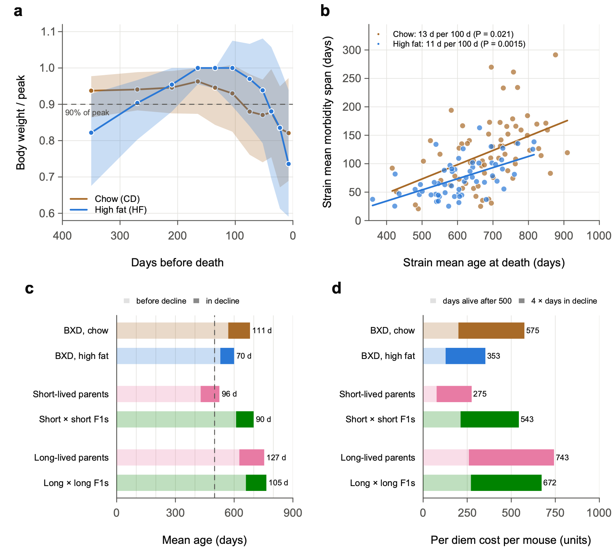

**Fig. 12 | Longer-lived BXD strains spend longer in terminal decline, but F1 hybrids of short-lived strains add life without adding decline.** **a**, Body weight of BXD-family females as a fraction of each mouse's peak (its highest weight at least 120 days before death), aligned on the day of death, on chow (brown; 7,041 weighings) and high fat (blue; 6,147 weighings). Points indicate medians and shaded bands interquartile ranges, in windows of 15–120 days. The dashed line marks 90% of peak, the threshold for terminal decline. Mice were weighed about every 66 days. **b**, Strain-mean morbidity span against strain-mean age at death, for BXD strains with at least 6 mice (68 strains on chow, 58 on high fat). Morbidity span runs from the onset of terminal decline (halfway between the last weighing at 90% of peak or more and the first below it, with no later recovery) to death. Lines show least-squares fits to the strain means. The key gives the slope from split halves, in which the lifespan and the span of each strain come from different mice, averaged over 200 random splits. *P* values come from 2,000 permutations of strain labels. Proportional change would give 18 and 12 days per 100 days. **c**, Mean age at onset of decline (pale) and mean morbidity span (dark), by group. *n* = 739 and 681 mice for BXD strains on chow and high fat; 92 short-lived parents (4 strains); 140 short × short F1s (6 F1 types); 120 long-lived parents (4 strains); 165 long × long F1s (7 F1 types). F1s and parents pool both diets. The dashed line marks 500 days. Short × short F1s live 171 days longer than their parents (95% CI 104–239; exact permutation over genotypes, *P* = 0.005) with the same morbidity span (difference 0 days, −32 to 32; *P* = 1.0). **d**, Per diem cost per mouse when mice are free until 500 days and then cost 1 unit per day alive (pale) plus 4 units per day in decline (dark). Means per mouse; the totals are at right. F1s euthanized at end of life, within a week or two of expected death as judged by frailty, are counted as natural deaths; euthanized BXD-family mice are included throughout, and results without them are in `output/Terminal_decline_tests.txt`. Six F1s recorded as BXD73 crosses are BXD73b crosses (`data/corrected/`). Exploratory; analysis plan approved before any comparison was run; *P* values are not corrected for multiple tests.

## Is this rectangularization?

Compression of morbidity can mean two things, and the data answer them differently.
- **Relative compression: is decline a smaller share of life?** Possibly, for the short × short F1s. Their decline is about 90 of 700 days (13%), against 96 of 525 days (18%) in their parents, but the difference is not significant (P = 0.07). Across the definitions of Part 5.1, the difference points the same way in 85% and is significant in 12%, so relative compression is suggestive, not established.
- **Absolute compression: are there fewer days of decline?** No. The decline lasts the same number of days; it simply comes later.
- **Across BXD strains,** longer life brings somewhat more days of decline, at close to the same share of life.

So in the short × short F1s, hybrid vigor postpones a terminal phase of about three months rather than shortening it. All the days it adds come before the decline.

## Things to keep in mind

- **Weighings are about two months apart, and the last one came a median of 32 days before death.** Of the 2,117 mice, 221 (10%) were weighed on the day they died, 125 of them euthanized mice, and 201 more within a week. (Version 1 said that no mouse was weighed at death. That was wrong.)
- **The 90% threshold and the 120-day window are choices.** The bounds of the span (onset as early or as late as the weighings allow) give the same answers. Part 5.1 tests 568 definitions: the F1 results and the high-fat link between lifespan and decline hold; the chow link and the diet effect on decline depend on the definition.
- **Euthanized BXD-family mice stay in every analysis.** They died somewhat younger, and less thin, than mice that died naturally. Leaving them out gives the same direction on every question.
- **The UM-HET3 version** (free until 700 days) is not possible with the published weights, which were taken at 6, 18 and 24 months only.
- **Full results:** `notes/Terminal_decline_results.md`.

## In plain words

- **In BXD mice, the last three months or so of life are marked by weight loss.**
- **Longer-lived strains spend somewhat longer in decline,** roughly in step with their longer lives.
- **Crossing two short-lived strains adds almost six months of life, all of it before the decline.**
- **On Rob's per diem,** those extra months cost the investigator more, about half as pension and half as surcharge, because the F1s' decline now falls after 500 days.

---

# Part 5: Definitions of decline, nicotinamide, rectangularization and tumors

All of Part 5 is exploratory, run on 27 October 2026. Rob approved each plan before its comparisons were run, except where marked. No P value is corrected for multiple tests.

## 5.1 How much do the Part 4 conclusions depend on the definition of decline?

### Question

Part 4 used one definition of decline: the first weighing below 90% of peak, with no later recovery. Many other definitions are just as defensible. Would a different reasonable choice have changed the conclusions?

### The plan

- **Written before the runs:** Claude wrote the plan (`notes/PLAN_morbidity_definitions.md`). Rob approved it on 27 October 2026, before any definition other than Part 4's was run.
- **568 definitions,** built from five choices:
  - the peak weight: four ways;
  - the weighings used: all, or without those flagged by the weight quality control (QC; `qc/BodyWeight_QC.md`);
  - the onset rule: ten rules (fixed lines from 80% to 95% of peak, a line set at equal risk of death on each diet, rates of loss, a change point and others), or two graded measures with no onset at all;
  - where onset falls between two weighings: two ways;
  - how the gap from the last weighing to death is filled: four ways.
- **Everything else stays as in Part 4:** the same 2,117 mice, the same tests and the same random draws for every definition.
- **The verdict rule was fixed in advance.** A conclusion is robust if it keeps its direction in every definition that changes one choice at a time and in at least 95% of all definitions. It must also keep its verdict (CI excluding zero, or not) in at least 90% of definitions and in the definition that best predicts death.

### How to read Fig. 13

**A specification curve** runs one analysis many times, once for each defensible set of choices, and shows every result side by side.
- **Panels a–e:** Each gray point is one definition's estimate divided by its standard error, and the points are sorted. Points outside the shaded band (about −2 to +2) have a 95% CI that excludes zero. The black dot is Part 4's definition; the open diamond is the definition that best predicts death.
- **A robust conclusion** keeps nearly all its points on one side of the band, as panel b does, or, for a robust absence of difference, inside it. **A sensitive one** has points on both sides, as panel e does.
- **Panel g** says which choice moves a conclusion. Each cell gives the percentage of definitions with that setting that reach Part 4's verdict.

### Which measure predicts death best

At each weighing from 300 days of age, each rule scores the mouse from what could be known at the time: in decline or not, or, for the graded measures, how far below peak. A Cox model then measures how well that score predicts death before the next weighing.
- **Concordance** is the chance that, of two mice of the same age, the one with the worse value dies first. A coin toss gives 0.5.

| Rule | Chow BXDs | High-fat BXDs | F1s | Mean |
|---|---|---|---|---|
| Percent below peak, graded | 0.616 | 0.659 | 0.709 | 0.661 |
| An interval losing more than 10% | 0.579 | 0.637 | 0.662 | 0.626 |
| Below 85% of peak | 0.585 | 0.627 | 0.652 | 0.621 |
| Below 90% of peak (Part 4) | 0.585 | 0.634 | 0.641 | 0.620 |
| Change point | 0.576 | 0.629 | 0.647 | 0.617 |
| Losing at least 2% a month | 0.572 | 0.629 | 0.640 | 0.614 |

- **Graded percent below peak predicts death best in every group.** On chow, risk rises about 1.41-fold for every 10 percentage points below peak. Risk climbs with each step of loss, so a single line throws information away.
- **Weight predicts death least well on chow,** where the decline is slow and mixed with ordinary weight loss in old age.

### Robust and sensitive conclusions

**Robust** (share of the 568 definitions that agree with Part 4)
- **On high fat, longer-lived strains spend more days in decline** (100%).
- **Short × short F1s spend the same number of days in decline as their short-lived parents** (94%), though they live 171 days longer.
- **Long × long F1s do not differ from their parents** (96–97%).
- **On chow, the decline is about the same share of life in short- and long-lived strains** (99%).

**Sensitive**
- **On chow, longer-lived strains spend more days in decline,** but only when decline starts at a shallow line (90–95% of peak), or under the change point or the graded measures (42% of definitions agree with Part 4). With a line at 85% or 80% of peak, at equal risk, against a stable baseline or with the rate rule, the effect disappears.
- **High fat shortens the decline** when decline means days below a fixed fraction of peak: 58% of all 568 definitions find it significantly shorter, as Part 4 did. When decline is measured at equal risk, by the rate of loss, against a stable baseline or as excess risk, 22% of all definitions find it significantly *longer*.
- **The short × short F1s spend a smaller share of life in decline than their parents** in 85% of definitions, but significantly so in only 12% (P = 0.07 in Part 4).
- **On high fat, the share of life spent below peak rises with lifespan** under both graded measures, but not under Part 4's definition.

**The definition that best predicts death agrees with Part 4 on every conclusion but one,** the high-fat share of life.

### Why chow and high fat differ

- **On chow, weight drifts down for months before the terminal fall.** Chow mice still more than a year from death are already about 6% below peak at 600–750 days.
  - A shallow line (90–95%) counts this drift as decline. Long-lived strains spend longer at old ages, so they collect more of it.
  - A deep line (80–85%), or a baseline taken 4–8 months before death, counts only the terminal fall, and that is not longer in long-lived strains.
- **On high fat, mice hold their peak until about three months before death, then crash.** Every definition gives the same result: the crash lasts longer in longer-lived strains.
- **So the two diets' declines differ in kind.** On high fat the decline is short, deep and risky. On chow it is long, shallow and less risky per day.
- **Which diet has "more" morbidity** depends on whether a day 12% below peak counts the same on both diets (Part 4's definition) or counts by its risk. That is a question of values as much as of data.

### What this changes in Part 4

- **Keep as stated:**
  - on high fat, longer-lived strains spend longer in decline;
  - short × short F1s add life without adding days of decline;
  - long × long F1s do not differ from their parents.
- **Qualify:**
  - the chow slope is a slope of mild weight loss, not of deep terminal decline;
  - high fat shortens the decline in days but makes it steeper and riskier;
  - the F1s' compression relative to lifespan is suggestive, not established.
- **For the paper:** Consider making graded percent below peak the main measure, since it predicts death best, with Part 4's 90% line as the simple alternative.

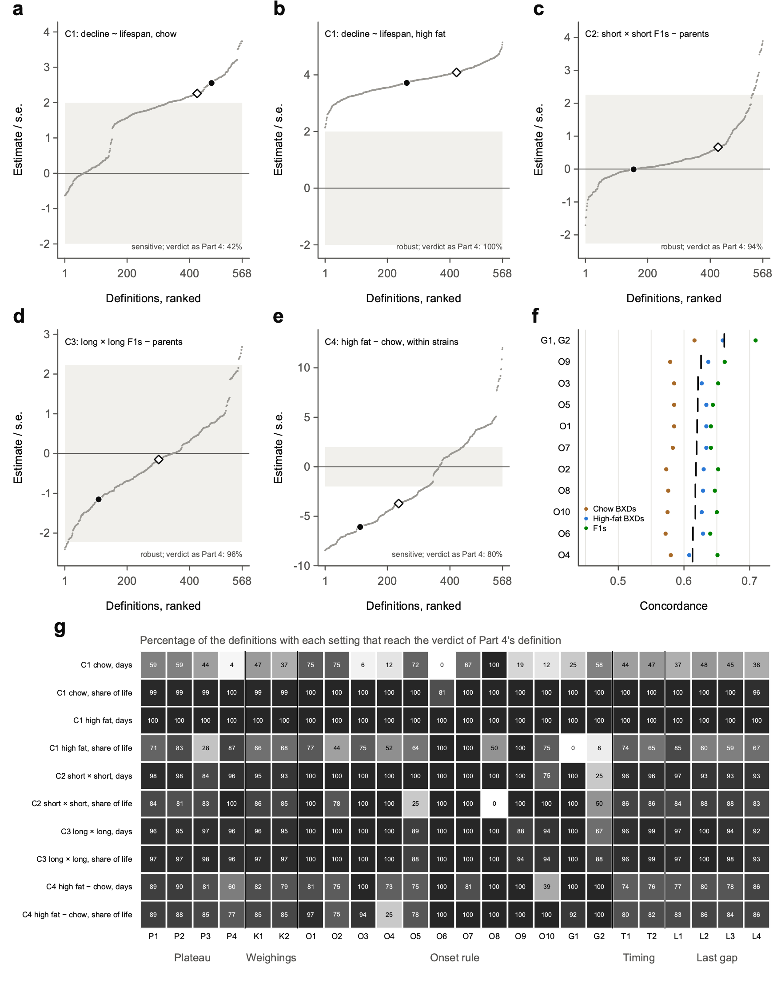

**Fig. 13 | Most conclusions about terminal decline hold across 568 definitions of its onset; the slope on chow and the effect of diet depend on the definition.** **a**–**e**, Specification curves. Each grey point is one of 568 definitions of terminal decline, built from five choices: the plateau weight (P1–P4); the weighings used (all, or without those flagged in `qc/BodyWeight_QC.md`); the onset rule (O1–O10), or a graded measure with no onset (G1, percentage-days below the plateau; G2, days weighted by excess risk); where onset falls between two weighings (T1, T2); and how the gap from the last weighing to death is filled (L1–L4). Points show each definition's estimate divided by its standard error, ranked; inside the shaded band the 95% CI includes zero. The black dot marks the definition of Part 4 (Fig. 12) and the open diamond the definition that best predicts death (**f**). **a**,**b**, Slope of strain-mean days in decline on strain-mean age at death, from split halves, for BXD strains with at least 6 mice (68 strains on chow, 58 on high fat). **c**, Short × short F1 hybrids minus their short-lived parents (10 genotypes). **d**, Long × long F1 hybrids minus their long-lived parents (11 genotypes). **e**, High fat minus chow within 81 BXD strains. *n* = 2,117 mice with a weighing at least 120 days before death. Standard errors come from delete-one-strain (or delete-one-genotype) jackknives; *P* values (in `output/Onset_definitions_tests.txt`) come from 2,000 permutations of strain labels (**a**,**b**), exact permutation over genotypes (**c**,**d**) or 10,000 sign flips (**e**), with the same random draws for every definition. Each panel gives the verdict under a rule fixed before the definitions were run. A conclusion is robust if it keeps its direction in every one-at-a-time definition and in at least 95% of all definitions, and its verdict (CI excluding zero or not) in at least 90% and in the definition that best predicts death. **f**, Concordance with death before the next weighing for each rule as it could be applied at the time (highest weight so far as the plateau; all weighings), from Cox models on age clustered by genotype: chow BXDs (brown; 5,020 intervals), high-fat BXDs (blue; 3,751) and F1 hybrids (green; 1,986). Vertical bars mark the mean of the three groups. G is the percentage below peak beyond a 5% band for weighing noise. **g**, Percentage of the definitions with each setting that reach the verdict of Part 4's definition, for each conclusion in days and as a share of life. Exploratory; analysis plan approved before any definition other than Part 4's was run; *P* values are not corrected for multiple tests.

## 5.2 Nicotinamide on a high-fat diet

### Question

Does adding nicotinamide (NAM), a form of vitamin B3 and a precursor of NAD⁺, to the high-fat diet change lifespan, the level or slope of mortality, the spread of ages at death, or the length of terminal decline?

### The plan and the mice

- **Written before the runs:** Claude wrote the plan (`notes/PLAN_NAM_rectangularization.md`). Rob approved it before any comparison of NAM with high fat was run.
- **The dose: 1% of the diet by weight,** chosen from Williams et al. 2017 (Rob, 27 October 2026). Williams et al. gave nicotinamide in drinking water.
  - On our high-fat diet (Envigo Teklad TD06414), that comes to roughly 600–750 mg/kg/day, close to the low dose of Williams et al. The estimate assumes a typical intake of 2.5–3 g a day for a 40 g female, not one measured in our mice.
  - de Cabo's doses (Mitchell et al. 2018) were 0.05% and 0.1% of diet, 10–20 times lower by concentration.
- **Primary design:** the TSRB vivarium only, where all NAM mice were housed, in the 9 strains with at least 3 mice in each arm: 69 NAM and 48 high-fat mice.
  - The strains are BXD2, BXD15, BXD75, BXD101, BXD170, BXD172, BXD190, BXD197 and C57BL/6J.
- **Here the strain is the unit.** Lifespan, spread and decline are the mean over strains of the within-strain difference, with P values from exact sign flips over strains (512 arrangements). The MRDT and the mortality at 600 days come from a Gompertz fit with a level for each strain and arm and one MRDT per arm, with animal-level likelihood-ratio P values. All 95% CIs come from a delete-one-strain jackknife.

### Results

| Measure | NAM against high fat (95% CI) | P |
|---|---|---|
| Mean age at death | +26 days (−95 to 148) | 0.62 |
| The same, every vivarium, adjusted for vivarium (22 strains) | +8 days (−66 to 81) | 0.83 |
| Mortality at 600 days | 0.84× (0.37 to 1.90) | 0.64 |
| MRDT, 86 days on high fat and 88 with NAM | ratio 1.02 (0.63 to 1.66) | 0.9 |
| Standard deviation of age at death | 0.92× (0.49 to 1.74) | 0.79 |
| Days in decline (Part 4's definition) | −18 days (−62 to 26) | 0.38 |

- **Nothing we could detect:** NAM changed neither lifespan, nor the level or slope of mortality, nor the spread of ages at death.
- **The decline was somewhat shorter with NAM** under all 18 day-based definitions in the one-at-a-time set of Part 5.1 (11 to 40 days), but significantly so under only one, the rate rule (P = 0.027). One in 18 is about what chance alone would give, and all 18 use the same mice.
- **With 9 strains, only large effects could have been seen.** These data rule out a large effect on lifespan, but not a moderate one.
- **This agrees with de Cabo's study.** In Mitchell et al. 2018, NAM changed neither median nor maximum lifespan in C57BL/6J males on either diet.

### Birth year: an imbalance (added after the results were seen)

**Vivarium is matched by design, but birth year is not.**
- The high-fat controls were born from 2015 to 2020, most in 2016–2019.
- The NAM mice were born from 2019 to 2022, 49 of 69 in 2021.

**At TSRB, chow and high-fat mice born later died younger.** Within strain, adjusted for diet, and with each mouse at risk from its set-up age:
- mortality rose 13% per later year of birth (hazard ratio 1.13, 95% CI 1.00–1.28, P = 0.044);
- the mean age at death fell 33 days per year (95% CI 16–50);
- the share of deaths by euthanasia rose from about a quarter for mice born in 2015–2016 to about two thirds for mice born from 2017 on. A change in when mice were judged moribund may be part of the trend.

**What that does to the NAM comparison** (NAM / high fat, Cox model stratified by strain)

| Version | Hazard ratio (95% CI) | P |
|---|---|---|
| As run (primary design) | 0.87 (0.58–1.32) | 0.51 |
| Adjusted for the birth-year trend of the chow and high-fat mice | 0.59 (0.39–0.89) | 0.011 |
| Both arms born 2018–2020 (26 NAM and 25 high-fat mice, 11 strains) | 1.04 (0.51–2.12) | 0.92 |

- **The adjusted row** fixes the trend at its estimate, so its CI is too narrow.
- **The same-years row** is the cleaner test, but it is small.

**The lesson:** A comparison across years carries whatever else changed over those years: husbandry, euthanasia practice, staff. The adjustment makes NAM look protective; the same-years comparison does not. These data can neither show nor exclude an effect of NAM of 10–40% on mortality. NAM and high-fat mice born in the same months would settle it.

**One more difference between the arms:** Some NAM mice lost weight in their first one to three weeks on the diet, then recovered. In the first five weeks, 13% of NAM mice lost more than 10% of their starting weight, against 0.2% of high-fat mice. If the mice refused the NAM diet at first, they had a short spell of food restriction.

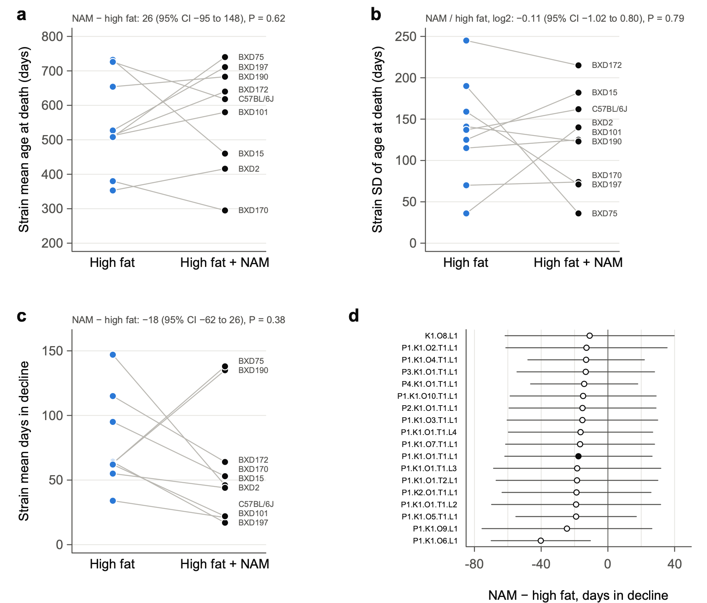

**Fig. 14 | Nicotinamide does not detectably change lifespan, the spread of ages at death or the length of terminal decline in BXD strains on a high-fat diet.** **a**–**c**, Strain means for BXD-family females fed high fat (blue) or high fat with 1% nicotinamide (NAM, black), housed at TSRB, in the nine strains with at least three mice in each arm (*n* = 48 and 69). Lines join the two arms of each strain. **a**, Mean age at death. **b**, Standard deviation of age at death. **c**, Mean days in terminal decline, as defined in Part 4 (Fig. 12), for the 108 mice weighed at least 120 days before death. Values above each panel give the mean over strains of the within-strain difference (for **b**, the log2 ratio of standard deviations), with 95% CI from a delete-one-strain jackknife and *P* from an exact sign-flip test over strains (512 arrangements). **d**, NAM minus high fat in days in decline under the 18 day-based definitions of the one-at-a-time set of Fig. 13. Points indicate estimates and bars indicate 95% CI; the filled point marks the definition of Part 4. Only the rate rule (O6) excludes zero (*P* = 0.027). Gompertz fits with a level for each strain × arm and one mortality rate doubling time (MRDT) per arm give MRDTs of 86 and 88 days (likelihood-ratio test, *P* = 0.9) and a NAM / high-fat mortality ratio at 600 days of 0.84 (95% CI 0.37–1.90). All NAM mice were housed at TSRB; using every vivarium, with a vivarium term (22 strains), NAM changes mean age at death by +8 days (95% CI −66 to 81). NAM mice were born later than their high-fat controls (mostly 2021, against 2016–2019), and at TSRB mortality rose with year of birth (hazard ratio 1.13 per year, 95% CI 1.00–1.28); with that trend removed, the NAM / high-fat hazard ratio is 0.59 (0.39–0.89), and among mice born in 2018–2020 it is 1.04 (0.51–2.12; 26 and 25 mice). Exploratory; analysis plan approved before any comparison was run, except the birth-year analysis, which was added after the results were seen; *P* values are not corrected for multiple tests.

## 5.3 Rectangularization side by side with de Cabo's studies

### Question

Rafa de Cabo is interested in a paper on rectangularization. So we set our comparisons beside his published studies of nicotinamide (Mitchell et al. 2018) and metformin (Martin-Montalvo et al. 2013), and asked of each treatment or cross: Does it make the survival curve more "rectangular", and in which sense?

### Three meanings of "rectangular"

A survival curve is rectangular when everyone lives to about the same age and then dies within a short span. The word is used in three senses, and they can move separately:
1. **Absolute:** Deaths crowd into fewer days (a smaller standard deviation, SD, of age at death). Under the Gompertz law, only a shorter MRDT does this.
2. **Relative:** Deaths crowd into a smaller share of the typical lifespan (a smaller coefficient of variation, CV, or a lower Keyfitz's H, the life-table entropy). A lower level of mortality does this by itself: it moves the whole curve later, so the same spread in days becomes a smaller share of a longer life.
3. **Compression of morbidity:** The sick period before death shrinks, so the curve of survival without decline moves closer to the survival curve (Part 4).

### Data

- **BXD comparisons** use the strain or genotype as the unit.
- **de Cabo's studies** used one inbred strain, C57BL/6 males, so the mouse is the unit.
  - We did not have the individual data, so `tools/digitize_km.py` read the ages at death from the published survival curves (`data/digitized/`).
  - **One panel was read exactly.** The metformin 0.1% figure is a vector drawing that carries a tiny hidden marker at every week under each curve.
  - **The others were read one column of pixels (one age) at a time,** by line style or by color. The readings match the figures to within a line width.
  - **Check against the papers:** Our change in mean lifespan is +6.9% for 0.1% metformin, against the reported +5.83%, and −17.3% for 1% metformin, against −14.4%.
- **The rules** for reading the curves and for every measure were written before any curve was read.

### Results

Ratios are treated / control; differences are treated minus control. Values are estimates with 95% CIs; **bold** marks a CI that excludes no change (1 for ratios, 0 for differences).

| Comparison | Mean age at death (days) | SD | CV | MRDT | Mortality at 600 days | Days in decline |
|---|---|---|---|---|---|---|
| **BXD family females** | | | | | | |
| High fat vs chow, within strains (76) | **−80** (−102 to −58) | **0.80** (0.71–0.90) | 0.91 (0.80–1.03) | **0.78** (0.69–0.88) | **1.91** (1.60–2.27) | **−42** (−56 to −28)ᵃ |
| Short × short F1s vs parents (10 genotypes) | **+179** (111–247) | 1.01 (0.64–1.61) | 0.75 (0.49–1.14) | **0.68** (0.49–0.93) | **0.33** (0.17–0.61) | 0 (−32 to 32)ᵃ |
| Long × long F1s vs parents (11) | +44 (−41 to 129) | 0.77 (0.58–1.01) | **0.72** (0.55–0.95) | 0.83 (0.63–1.10) | 0.70 (0.33–1.47) | −18 (−53 to 17)ᵃ |
| High fat + 1% NAM vs high fat (9 strains, TSRB) | +26 (−95 to 148) | 0.92 (0.49–1.74) | 0.89 (0.42–1.89) | 1.02 (0.63–1.66) | 0.84 (0.37–1.90) | −18 (−62 to 26) |
| **C57BL/6 males, de Cabo** | | | | | | |
| High fat vs standard diet | **−157** (−193 to −124) | 1.17 (0.94–1.48) | **1.43** (1.11–1.84) | 1.12 (0.87–1.50) | **4.70** (2.95–8.01) | — |
| 0.05% NAM vs standard diet | −22 (−56 to 11) | 1.09 (0.84–1.41) | 1.12 (0.84–1.47) | 1.01 (0.80–1.31) | 1.22 (0.70–2.19) | — |
| 0.1% NAM vs standard diet | −25 (−61 to 9) | 1.15 (0.90–1.50) | 1.19 (0.90–1.56) | 1.22 (0.95–1.58) | 1.64 (0.98–2.79) | — |
| High fat + 0.05% NAM vs high fat | +20 (−20 to 59) | 1.11 (0.96–1.30) | 1.08 (0.90–1.31) | 1.12 (0.81–1.55) | 0.86 (0.54–1.37) | — |
| High fat + 0.1% NAM vs high fat | +5 (−33 to 42) | 0.99 (0.85–1.17) | 0.99 (0.82–1.18) | 1.02 (0.75–1.37) | 0.96 (0.62–1.52) | — |
| 0.1% metformin vs standard diet | **+57** (14–99) | 0.88 (0.70–1.10) | 0.82 (0.64–1.06) | 0.94 (0.72–1.20) | 0.56 (0.29–1.04) | — |
| 1% metformin vs standard diet | **−150** (−186 to −115) | **0.71** (0.56–0.88) | 0.85 (0.66–1.10) | **0.60** (0.47–0.78) | **2.87** (1.64–5.13) | — |

- **ᵃ** From Part 4's definition of decline; for high fat against chow, over Part 4's 81 strains. The diet difference depends on the definition (Part 5.1); the two F1 results do not.
- **"—"** means that there are no individual weights.
- **Keyfitz's H and the interquartile range** are in `output/Rectangularization_tests.txt`.

**What the table says**
- **Hybrid vigor is the clearest case of rectangularization with a longer life.**
  - Short × short F1s live 179 days longer than their parents, with the same spread of ages at death in days. So their deaths are less spread relative to lifespan (Keyfitz's H lower, P = 0.014).
  - Their mortality at 600 days is a third of their parents', and it doubles faster (MRDT 89 against 131 days).
  - They spend the same number of days in decline (Part 4). So their spread of deaths and their decline keep the same length in days and shrink as a share of a longer life: relative rectangularization, not absolute (SD 1.01×). All the added days come before the decline.
- **Long × long F1s live no longer than their parents, but their deaths are less spread relative to lifespan** (CV 0.72×, P = 0.036), and perhaps in days too (SD 0.77×, 95% CI 0.58–1.01).
- **High fat, within BXD strains, narrows the spread of ages at death, but only in days.** The SD falls to 0.80× (P = 0.0001) while the CV is unchanged. That is what the shorter MRDT, 91 against 117 days, predicts (Part 1).
- **Nicotinamide detectably changed none of the measures,** in any study, at any dose: our 1% on high fat, and de Cabo's 0.05% and 0.1% on the standard diet and on high fat.
- **Metformin at 0.1% moved the curve later without changing its shape:** mean +57 days, with mortality at 600 days 0.56×. That is a level effect, not rectangularization.
- **Metformin at 1% is a warning.** It packed deaths into a narrow band (SD 0.71×) by steepening the rise of mortality (MRDT 0.60×), and it killed the mice 150 days sooner. Rectangularization by itself is not good news. It is good only when lifespan and health go up with it.
- **High fat in de Cabo's B6 males made the curve *less* rectangular in relative terms** (CV 1.43×, P = 0.003). In BXD females the CV was unchanged. The designs differ: one strain of males started at 56 weeks, against many strains of females started young.

### A puzzle: hybrid vigor and the MRDT

- **The short × short F1s' MRDT is shorter than their parents'** (89 against 131 days), yet their SD of age at death is the same.
- **Under the Gompertz law, a shorter MRDT should narrow the SD.** The two measures disagree here. Part 2 found the same shorter MRDT (Fig. 6, ratio 0.63).
- **A possible reason:** The short-lived parental strains carry early deaths that rise little with age. These flatten the parents' fitted MRDT without widening the spread of the deaths that follow. This fits the model of Fig. 8, in which load adds deaths of its own.
- **Worth a closer look before the paper,** with the Makeham check of Part 3.6.

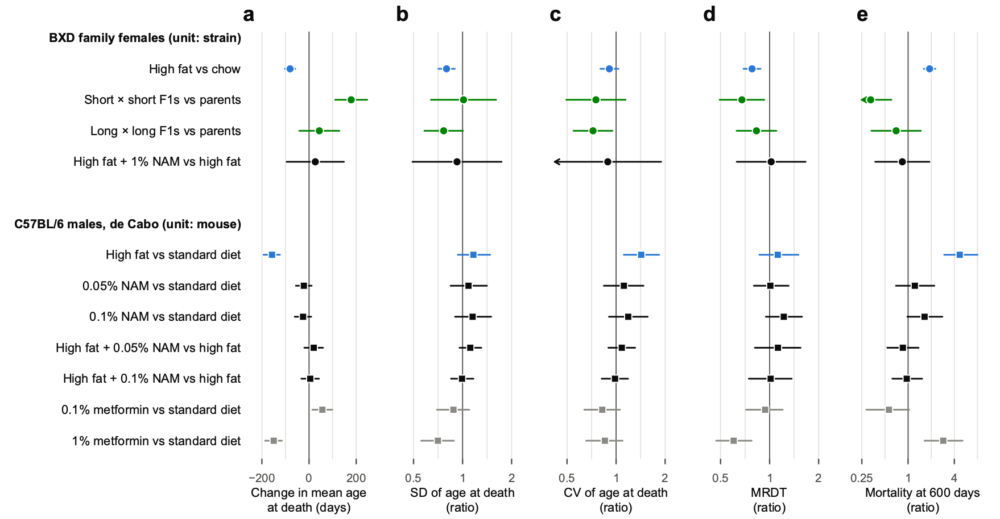

**Fig. 15 | Hybrid vigour lengthens life and concentrates deaths relative to lifespan; nicotinamide changes neither, and a toxic dose of metformin concentrates deaths while shortening life.** Each row compares a treated or crossed group with its control, and the same rows appear in every panel. **a**, Change in mean age at death (days). **b**, Ratio of the standard deviation of age at death (absolute spread). **c**, Ratio of the coefficient of variation of age at death (spread relative to lifespan). **d**, Ratio of the mortality rate doubling time (MRDT). **e**, Ratio of the mortality rate at 600 days. Ratios are shown on log2 scales. Circles, BXD-family females, with the strain or genotype as the unit: high fat against chow within the 76 strains with at least 5 mice on each diet (*n* = 916 and 809); short × short F1 hybrids (6 types, *n* = 143) against their short-lived parents (4 strains, *n* = 95) and long × long F1s (7 types, *n* = 165) against their long-lived parents (4 strains, *n* = 124), in genotype × diet cells of at least 5 mice, adjusted for diet; high fat with 1% nicotinamide (NAM) against high fat in 9 strains at TSRB (*n* = 69 and 48; Fig. 14). Squares, male C57BL/6 mice from de Cabo's laboratory, with the mouse as the unit; ages at death were rebuilt from the published Kaplan–Meier curves of Mitchell et al. 2018 (NAM at 0.05% and 0.1% of diet on a standard or high-fat diet from 56 weeks of age; *n* = 100 per arm) and Martin-Montalvo et al. 2013 (metformin at 0.1% and 1% of diet from 54 weeks; *n* = 83 and 64, 88 and 90). Colours: high fat blue, F1 hybrids green, nicotinamide black, metformin grey. Points indicate estimates and bars indicate 95% CI: for BXD, a delete-one-strain (or delete-one-genotype) jackknife with *t* on units − 1 d.f.; for de Cabo's studies, the 2.5th–97.5th percentiles of 2,000 bootstrap resamples of mice within arm. Arrows mark intervals that extend beyond the axis. MRDTs come from Gompertz fits by maximum likelihood, with each mouse at risk from its age at set-up (BXD) or at the start of treatment (de Cabo), a level for each strain × diet or genotype × diet cell, and one MRDT per group. Within strains, high fat shortens the MRDT from 117 to 91 days (likelihood-ratio test, *χ*² = 30.3, 1 d.f., *P* = 4 × 10⁻⁸); pooled over strains it does not (Fig. 1). Short × short F1s have an MRDT of 89 days against 131 for their parents (*χ*² = 10.3, 1 d.f., *P* = 0.0013), with an unchanged s.d. of age at death. Exploratory; the rules for reading the curves and for every measure were fixed before any curve was read; *P* values are not corrected for multiple tests.

## 5.4 Do tumors hide terminal weight loss?

### Question

Between 25% and 34% of our mice were still within 10% of their peak weight in their last month. Rob asked:

> "Fascinating that some mice resist weight loss but not death. Solid tumors? What types of murine cancers associated with tumor weights of 2 to 6 g? We may have some data for Roy et al. 2021 in which we did a bit of pathology."

This analysis was added after the Part 4 results were seen (`BodyWeight/masses_notes.R`).

### What our records show

- **The only pathology in our files is free text,** in the colony's notes columns of the BXD workbook. In the Part 4 sample, 85 mice have notes from a necropsy, nearly all born in 2018–2019, and 63 of them had an internal mass, an enlarged organ or fluid. The organs named most often are the liver and spleen, then the ovary and uterus.
- **A large mass can hide wasting.** We have vivid cases: one BXD184 mouse died at 150% of its peak weight, with an abdomen full of milky fluid, a large mass in the mesentery and masses in the liver.
- **But recorded masses do not explain most of the mice that die without losing weight.**
  - Among mice weighed within a week of death, those with a recorded mass were no closer to their peak than the rest. Within strain, adjusted for diet, euthanasia and the days from the last weighing to death, the difference was −0.05 of peak (95% CI −0.14 to +0.04, P = 0.28).
  - Of the 96 mice at 95% of peak or more at death, 31 (32%) had a mass recorded, against 26% of the 326 below it.
  - **Caution:** Most mice were never necropsied, so many internal tumors went unrecorded. That blurs the contrast.
- **Which masses could weigh 2–6 g** in old B6, D2 and BXD females:
  - lymphoma and histiocytic sarcoma, which swell the spleen, liver and lymph nodes, and the uterus in the case of histiocytic sarcoma;
  - liver tumors, uterine masses, and ovarian tumors or cysts;
  - fluid: ascites, blood in the abdomen, fluid in the chest.
- A chow-fed BXD female weighs about 30 g, so a 3 g mass hides a 10% loss.
- **The opposite case is pituitary tumors.** They are common in old B6 females but weigh milligrams, so they cannot hide weight loss.

### What would settle it

1. **The per-mouse diagnoses behind Roy et al. 2021 Table 1** (155 necropsied BXD females): With them we could compare the last months of weight in lymphoma deaths, other cancers, heart deaths and the rest. We found no study that compares terminal weight loss by cause of death in mice, so ours could be the first.
2. **The bodies in formalin:** If those bodies still exist, weighing the tumor-free carcass, or simply the spleen, liver and uterus, would measure the masking directly.
3. **Organ weights at necropsy from now on:** Weighing the spleen, liver, uterus and any mass would take a few minutes per mouse.

## 5.5 Things to keep in mind

- **Everything in Part 5 is exploratory,** with no correction for multiple tests.
- **The 568 definitions are not independent.** They share the same mice and weighings, so the shares in 5.1 say how fragile a conclusion is to choices, not how likely it is to be true.
- **de Cabo's ages at death are rebuilt from figures.** Our CIs treat every mouse as dying when the curve says, so mice the authors censored make those CIs a little too narrow. The studies differ from ours in sex, genotype, age at the start of treatment, diet and dose, so the rows of Fig. 15 compare directions, not sizes.
- **The NAM comparison carries the birth-year imbalance,** and NAM was given only at TSRB.
- **The weight QC** (`qc/BodyWeight_QC.md`) flagged odd records that Suheeta Roy is reviewing, including two NAM mice whose recorded ages at death look wrong. Definitions without the flagged weighings are among the 568 of 5.1.
- **Full results:** `notes/Onset_definitions_results.md`, `notes/NAM_rectangularization_results.md`, `notes/Rectangularization_results.md` and `notes/Masses_and_terminal_weight.md`.

## 5.6 What we would ask for

1. **From Rafa de Cabo and Sarah Mitchell,** for the nicotinamide and metformin studies: each mouse's age at death, with a flag for censored mice, and its body weights. With these, de Cabo's rows gain the days in decline, and the CIs will account for censored mice.
2. **The same for Mitchell et al. 2016** (*Cell Metabolism* 23:1093): C57BL/6J and DBA/2J, both sexes, fed freely or under 20% or 40% calorie restriction. These are the BXD parents, and calorie restriction is the classic test of rectangularization.
3. **The per-mouse necropsy diagnoses** behind Roy et al. 2021.
4. **NAM and high-fat controls born in the same months,** if any exist that are not in the mapping file.

## In plain words

- **How long a mouse's decline lasts depends partly on how you define decline.** The F1 result does not: hybrids of short-lived strains add about six months of life and no days of decline, under almost any definition.
- **On high fat the end comes sooner and harder:** fewer days of decline, but steeper weight loss and a higher risk on each day.
- **Nicotinamide at 1% did not detectably help BXD females on high fat.** A birth-year imbalance means that a modest benefit cannot be ruled out.
- **A rectangular survival curve is good news only when life gets longer too.** Hybrid vigor does that. A toxic dose of metformin makes the curve rectangular while killing mice sooner.

---

## Appendix: files

All paths are in the repository.

| What | Code | Output |
|---|---|---|
| Part 1 | `Gompertz/MRDT_Diet.R`, `Gompertz/Diet_by_strain.R`, `Gompertz/Figures_MRDT_Diet.R` | `output/MRDT_by_diet.txt`, `output/Diet_by_strain*.txt`, Figs 1–5 |
| Part 1, MRDT by diet within strains | `Gompertz/Rectangularization.R` | `output/Rectangularization_tests.txt` (rows "high fat vs chow") |
| Part 2 | `Gompertz/MRDT_Secondary.R`, `Gompertz/Figures_MRDT_Secondary.R` | `output/MRDT_secondary_*.txt`, Figs 6–7 |
| Part 2 model | `Models/effective_factors.R`, `Models/fig_effective_factors.R` | `output/Model_effective_factors.*` (Fig. 8) |
| Table 2, clean copy | `UMHET3/clean_table2.R` | `data/umhet3/Table2/` |
| Genotype checks | `UMHET3/chr1_marker_check.R`, `UMHET3/vcf_set_check.R` | `output/UMHET3_markers_*.txt`, `output/UMHET3_31Mb_father_by_mother.txt`, `output/UMHET3_VCF_*` |
| Table 2 fits by sex | `UMHET3/vita1a_gompertz.R`, `UMHET3/vita_sex_stratified.R` | `output/UMHET3_Vita1_sex_stratified.txt` |
| Fits by site and cohort | `UMHET3/vita1_site_check.R` | `output/UMHET3_Vita1_site_check.txt` |
| Part 3 figures | `UMHET3/Figures_Part3.R` | Figs 9–11 |
| Part 4, corrected F1 table | `BodyWeight/F1_weights_corrected.R` | `data/corrected/` |
| Part 4 | `BodyWeight/terminal_decline.R`, `BodyWeight/Figures_terminal_decline.R` | `output/Terminal_decline_*.txt`, Fig. 12 |
| Weight QC | `BodyWeight/weights_QC.R` | `qc/BodyWeight_QC.md`, `qc/BodyWeight_flags.txt` |
| Part 5.1, definitions of decline | `BodyWeight/morbidity_functions.R`, `BodyWeight/onset_definitions.R`, `BodyWeight/Figures_onset_definitions.R` | `output/Onset_definitions_*.txt`, Fig. 13 |
| Part 5.2, nicotinamide | `Gompertz/NAM_rectangularization.R`, `Gompertz/Figures_NAM.R` | `output/NAM_rectangularization_tests.txt`, `output/NAM_by_strain.txt`, Fig. 14 |
| Part 5.3, rectangularization | `tools/digitize_km.py`, `Gompertz/Rectangularization.R`, `Gompertz/Figures_Rectangularization.R` | `data/digitized/`, `output/Rectangularization_*.txt`, Fig. 15 |
| Part 5.4, tumors | `BodyWeight/masses_notes.R` | `output/Masses_notes.txt` |

**Sources**
- Arends D, Ashbrook DG, Roy S, … Miller RA, Williams RW (2026). Dynamics of genetic and somatic trade-offs in ageing and mortality. *Nature* 654:437.
- Roy S, Bou Sleiman M, Jha P, … Auwerx J, Williams RW (2021). Gene-by-environment modulation of lifespan and weight gain in the murine BXD family. *Nature Metabolism* 3:1217–1227.
- Fries JF (1980). Aging, natural death, and the compression of morbidity. *New England Journal of Medicine* 303:130–135.
- de Magalhães JP, et al. (2018). A reassessment of genes modulating aging in mice using demographic measurements of the rate of aging. *Genetics* 208:1617–1630.
- Martin-Montalvo A, Mercken EM, Mitchell SJ, … Bernier M, de Cabo R (2013). Metformin improves healthspan and lifespan in mice. *Nature Communications* 4:2192.
- Mitchell SJ, Madrigal-Matute J, Scheibye-Knudsen M, … Bernier M, de Cabo R (2016). Effects of sex, strain, and energy intake on hallmarks of aging in mice. *Cell Metabolism* 23:1093–1112.
- Mitchell SJ, Bernier M, Aon MA, … Baur JA, de Cabo R (2018). Nicotinamide improves aspects of healthspan, but not lifespan, in mice. *Cell Metabolism* 27:667–676.
- Williams PA, Harder JM, Foxworth NE, … Smithies O, John SWM (2017). Vitamin B3 modulates mitochondrial vulnerability and prevents glaucoma in aged mice. *Science* 355:756–760.
